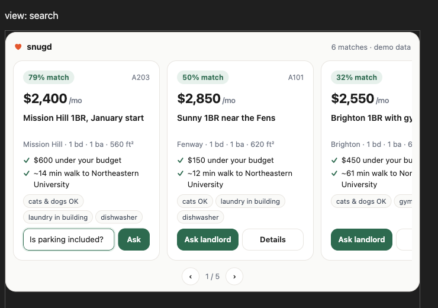
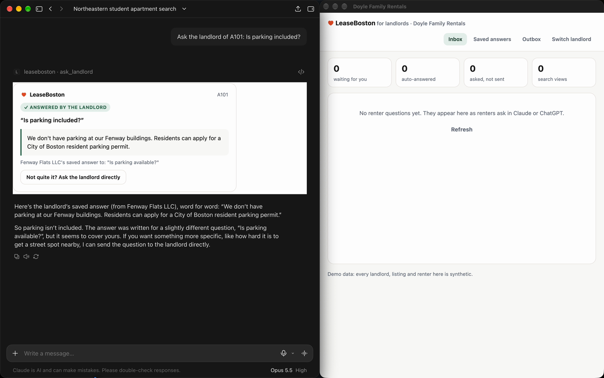
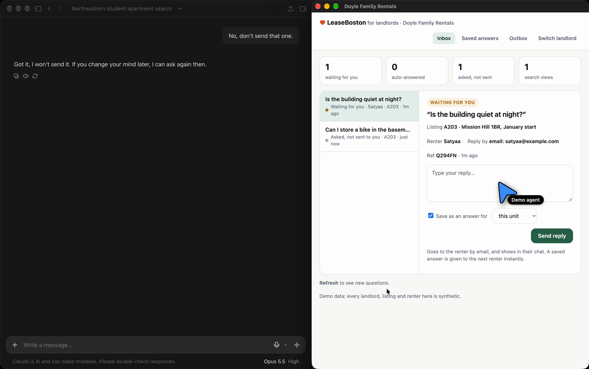

# LeaseBoston: apartment search inside Claude

A renter finds an apartment **inside Claude or ChatGPT**, and asks the landlord
questions there too. The landlord's own premade answer comes back instantly. If
there isn't one, the question goes to the landlord's queue (only if the renter
says yes), and the landlord's reply reaches the renter by email, SMS, the
LeaseBoston app, or right in the chat.

The AI never guesses a landlord's answer. It returns the landlord's saved text,
or hands the question to the landlord.

> **All data is synthetic.** Twenty made-up listings from six made-up landlords
> in real Boston neighbourhoods. Coordinates for neighbourhoods and landmarks
> come from Apple Maps. Every price, policy and answer is invented.

**Demo video:** [`docs/demo.mp4`](docs/demo.mp4) (3 min 47 s). It is recorded live in Claude Desktop on a Mac and
driven by [agent-desktop](https://github.com/vercel-labs/agent-desktop). Seven scenes: search, a saved answer, sending a
question, declining to send, the landlord replying, the renter seeing the reply, and the next renter getting the new answer
instantly.

| In the chat (MCP App cards) | The landlord's inbox |
|---|---|
|   |  |

**How it works, part by part:** [`docs/architecture/`](docs/architecture/README.md). There is an overview diagram,
8 sub-diagrams for the big parts, and a hand-drawn animation for every smallest piece. Each part is explained with
links to the exact lines of code. The same diagrams are clickable on
[satyaasudarshan.me](https://satyaasudarshan.me/#leaseboston).

| Folder | What is in it |
|---|---|
| `leaseapp/` | The MCP server, the in-chat card (`ui/app.html`), the landlord inbox, and the rules (`service.py`) |
| `tests/` | 29 tests, plus `mutation_check.py`, which breaks each safety guard on purpose and expects a test to fail |
| `demo/` | The scripts that drove Claude Desktop and recorded the demo video |
| `docs/` | The video, screenshots, and the architecture diagrams with their explanations |

## The two parts

```
 RENTER (in Claude / ChatGPT)                         LANDLORD (inbox)      
 ───────────────────────────                          ─────────────────────
 "2BR near Northeastern, cat, $3000"
        │
        ▼
 search_apartments ── ranked list + why it fits ─┐    Shown-in-search counts
 get_apartment                                    └──► per unit
        │
 "Is parking included at A101?"
        ▼
 ask_landlord ── saved answer matches? ──yes──► landlord's answer, word for word
        │                                         (logged: "answered by your saved answer")
        no
        ▼
 AI: "Landlord hasn't answered this. Send it to them? How should they reply?"
        │ renter says yes
        ▼
 send_question_to_landlord ───────────────────────►  email to landlord (new question)
        │                                            + "Waiting for your reply" queue
        │                                                    │ landlord types a reply
        │                                                    ▼
        │                          reply ◄──────────── Send reply (+ save as premade answer)
        │                            │
        │      email / sms / app ◄───┘
        ▼
 check_landlord_reply ── "The landlord replied: …"
```

**Part 1, the MCP server** (`leaseapp/mcp_server.py`) has five tools:

| Tool | Layer | What it does |
|---|---|---|
| `search_apartments` | Search | Hard filters (budget, beds, pets, move-in date, must-haves, areas), then a 0-100 fit score from budget room, distance to where they commute, and nice-to-haves. Every result says *why* it fits. If few fit, it lists near-misses and the one filter that ruled each out. |
| `get_apartment` | Search | Full listing details. |
| `ask_landlord` | Landlord layer | Returns the landlord's **saved answer** if one fits, otherwise `not_answered` plus a reference code. Every question is logged for the landlord either way. |
| `send_question_to_landlord` | Landlord layer | Queues the question and notifies the landlord. The server instructions say to call it only after the renter says yes. Calling it twice never sends twice. |
| `check_landlord_reply` | Landlord layer | The landlord's reply, by reference code. |

**In-chat cards (MCP App, `leaseapp/ui/app.html`).** `search_apartments` and `ask_landlord` are bound to one
`ui://leaseboston/card.html` resource, and Claude Desktop draws it in the chat. It has three views:

- **Listing carousel.** Each tile has an **Ask landlord** box, which puts the question in the renter's message box for
  them to send.
- **The landlord's answer**, quoted and labelled.
- **A consent form** for questions with no saved answer. The renter's own click on **Send to landlord** calls
  `send_question_to_landlord` from the card, so consent comes from the renter, not from the model's judgement.

Hosts without MCP Apps get the same data as text. The card speaks the ext-apps protocol (2026-01-26) by hand:
`ui/initialize`, then `ui/notifications/initialized`, `tool-input`/`tool-result`, `tools/call`, `ui/message` and
`size-changed`. There are no external scripts, which suits the host's default content security policy.

**Part 2, the landlord page** (`leaseapp/landlord_web.py`) is where the data
arrives at the vendor end:

- **Inbox.** Stat tiles at the top (waiting, auto-answered, asked but not sent, search views). Every question renters
  asked sits in a list with status dots, and the open question shows the renter, the listing and how they want the
  reply.
  - **Waiting** questions get a reply box, with "save as an answer for this unit / all my units".
  - **Auto-answered** questions show which saved answer matched, and its score.
  - **Asked, not sent** questions show demand the landlord has no answer for yet. One field adds a saved answer, so the
    next renter gets it instantly.
- **Saved answers.** The premade answers, plus a units table: search views and questions per unit.
- **Outbox** (`/outbox`). Every email, SMS and app notification, sent or simulated.

## Run it

Needs [uv](https://docs.astral.sh/uv/). The database creates and seeds itself on first run (`data/lease.db`).

```bash
uv sync
uv run python -m leaseapp serve          # MCP at http://127.0.0.1:8000/mcp, landlord page at http://127.0.0.1:8000/landlord
uv run python -m leaseapp reset          # wipe and reload the demo data
uv run pytest -q                         # 29 tests
```

### In Claude Code

```bash
claude mcp add leaseboston -- uv --directory /ABSOLUTE/PATH/TO/LeaseBoston run python -m leaseapp stdio
```

Or over HTTP while `serve` is running: `claude mcp add --transport http leaseboston http://127.0.0.1:8000/mcp`.

### In Claude Desktop

From the official guide ([Connect to local MCP servers](https://modelcontextprotocol.io/docs/develop/connect-local-servers), read 2026-11-21):

1. Open the Claude menu in the macOS menu bar (not the settings inside the window), then **Settings… → Developer → Edit Config**. This opens `~/Library/Application Support/Claude/claude_desktop_config.json`.
2. Add the server. Paths must be absolute. If Claude Desktop can't find `uv`, put the full path from `which uv` in `command`.

   ```json
   {
     "mcpServers": {
       "leaseboston": {
         "command": "uv",
         "args": ["--directory", "/ABSOLUTE/PATH/TO/LeaseBoston", "run", "python", "-m", "leaseapp", "stdio"]
       }
     }
   }
   ```
3. Quit Claude Desktop completely and reopen it. Problems show up in `~/Library/Logs/Claude/mcp*.log`.

Keep `uv run python -m leaseapp serve` running in a terminal too, to see the landlord page. Both read the same database.

### In ChatGPT

ChatGPT can only reach a server at a public HTTPS address, so put a tunnel in front of `serve`:

```bash
uv run python -m leaseapp serve --port 8000 --public-host <the-tunnel-hostname>
cloudflared tunnel --url http://localhost:8000      # prints a temporary https://….trycloudflare.com address
```

Start `cloudflared` first to learn the hostname, then restart `serve` with it. `--public-host` tells the server to accept that hostname. The SDK otherwise answers only localhost, as a guard against DNS rebinding. The landlord page stays localhost-only, even through the tunnel.

The server answers with plain JSON rather than a stream, because Cloudflare's quick tunnels don't support Server-Sent Events.

Then, per OpenAI's [Connect and test your plugin](https://developers.openai.com/apps-sdk/deploy/connect-chatgpt) page (read 2026-11-21):

1. Go to **chatgpt.com/plugins** → **+** → **Add custom MCP server**.
2. Enter the URL **including `/mcp`** and choose no authentication.
3. Create it, then start a new chat and type `@` to pick it.

**Check your plan first.** OpenAI's pages disagreed when read on 2026-11-21. Some say custom MCP servers need Developer mode, and that only Business, Enterprise and Edu plans get write actions. The page above mentions neither. The Settings screen in ChatGPT is the final word.

If ChatGPT can't connect and the `serve` log says `Invalid Origin header: X`, restart with `--allow-origin X`. This wasn't tested with ChatGPT.

### Real email

Set these and email replies go out for real. Without them, every message is simulated in the outbox:

```bash
export SMTP_HOST=smtp.gmail.com SMTP_PORT=587 SMTP_USER=you@gmail.com SMTP_PASSWORD='app password' SMTP_FROM=you@gmail.com
```

Addresses at `example.com` (all the demo landlords) are never really sent. That domain is reserved and can't receive mail. SMS and app notifications are simulated. `leaseapp/notify.py` is the one place to plug a real provider in.

## How "already answered?" is decided

`leaseapp/matcher.py` uses plain code, no model, so the same question always gets the same result:

1. It reduces both questions to topic words. Filler words are dropped and synonyms are folded together ("dog", "cats" → `pet`; "car", "garage", "driveway" → `parking`).
2. It weights each word by how rare it is across all saved questions.
3. The score is the average of the shared weight over all words and the shared weight over the renter's words.
4. There's no match unless the two questions share a real topic word. "Is parking included in rent?" must not match "Are utilities included in the rent?" just because both say *included* and *rent*. A test pins this.
5. At a score of 0.5 or more, the landlord's saved answer goes back **word for word**, along with the saved question it matched, so the renter can see what was answered.

When unsure, it fails safe. A missed match sends the question to the landlord, never a wrong answer in the landlord's name. A smarter matcher, such as embeddings or an LLM judge, can replace `best_match` without touching anything else.

## What was tested

- **29 automated tests** (`tests/test_mvp.py`), including one that checks the card is attached to the right tools:
  - 18 matching cases, including the two traps above.
  - Ranking and near-misses.
  - Contact validation.
  - Send-twice-sends-once.
  - A landlord can't answer another landlord's question.
  - The full journey over **stdio** and over **HTTP**: search → saved answer → unanswered → send → landlord replies through the real form → renter sees the reply → the next renter gets it instantly.
  - The landlord page refuses non-localhost hosts.
  - `/mcp` accepts the tunnel host and rejects others.
- **Mutation checks** (`uv run python tests/mutation_check.py`). Each of five guards was broken on purpose (topic-word rule, localhost-only page, send-once, save-reply-as-answer, landlord ownership), and a test failed every time.
- **Real Claude (Haiku 5.5, Claude Code headless), 5 sessions, checked against the database.** The first four ran over stdio:
  - Search → ask → not answered → sent with the renter's consent. The landlord was notified and the renter got a confirmation.
  - Parking and deposit questions were answered with the landlord's saved text, word for word.
  - A new question **with no consent given**: Claude asked "Should I send it?" and sent nothing (`not_sent` in the database).
  - After a landlord reply through the page: Claude reported the reply, then sent a second question with SMS as the reply channel.
  - Over HTTP: a search for a 2BR near MIT with a dog, then a parking question that correctly came back not answered. Nothing was sent, because the renter hadn't been asked.

- **Claude Desktop (Opus 5.5), with the in-chat cards, driven by agent-desktop and recorded:** two full takes of the 7 scenes,
  checked against the database. Take 1 found the "answers from chat history" bug and a framing problem, and the retake is
  the video. In both takes, scenes 2 to 5 behaved correctly: the saved answer was served, the question was sent from the
  card, and the not-sent question stayed `not_sent`.

**Not tested:** ChatGPT (it needs a public HTTPS address and a plan that allows custom MCP servers), and real SMTP sending, because no email account was configured.

## Known limits (it's an MVP)

- **No logins.** Anyone with a reference code can read that reply. The landlord page has no login, so it only answers on localhost. A real version would sign renters in (MCP supports OAuth) and tie questions to the verified user, not just a code.
- **Consent is only half enforced by code.** In Claude Desktop, the card's **Send to landlord** button is the renter's own
  click. But `send_question_to_landlord` stays visible to the model, for hosts without cards, so there the model's
  judgement still decides. That judgement held in every run here.
- **Claude can answer from chat history.** In the first recorded take, Claude did not call `ask_landlord` again for a repeat
  question, and missed the landlord's new answer. The server instructions now say to re-ask every time. The retake
  confirmed the fix, with the answer served at match score 1.0.
- **Question text goes to the landlord as typed.** If a renter writes personal details into a question, the landlord sees them.
- **The matcher is word-based**, so paraphrases with no shared topic word ("can I see it this weekend?" vs "Can I schedule a tour?") go to the landlord instead of being answered.
- **Single SQLite file**, fine for a demo, not for many concurrent users.
