# How LeaseBoston works, part by part

Every part of the system is explained here. A big part has its own architecture diagram (open the `.html` file in a browser). Its smallest pieces each have a hand-drawn animation. Code links point to commit [`9f140fd`](https://github.com/1AlgoRythm/LeaseBoston/tree/9f140fd2ef6d25c2a4d41b81522ebe0317c5771e).

The overview diagram is [`index.html`](index.html). The portfolio version, with clickable boxes, is on [satyaasudarshan.me](https://satyaasudarshan.me/#leaseboston).

## MCP server

*The single door Claude and ChatGPT use to reach LeaseBoston*

Diagram: [`mcp.html`](mcp.html)

I am the one MCP server, named leaseboston, that Claude or ChatGPT talks to. MCP, the Model Context Protocol, is a standard way for a chat app to call tools. I offer five tools: search_apartments, get_apartment, ask_landlord, send_question_to_landlord and check_landlord_reply. I run over stdin/stdout for Claude Desktop and Claude Code, or over HTTP at /mcp for ChatGPT. I also give the model a short instruction text that tells it how to behave.

**Why it matters.** Every chat app sees only what I declare, so my tool types and instruction text decide whether the model behaves safely. Without my host check and transport choices, ChatGPT could not reach a laptop through a tunnel. Without the instructions, the model might guess a landlord's policy.

**Smallest pieces:**

- `mcp`: The MCPServer object named leaseboston that holds the tools, the instructions and the card extension.
- `INSTRUCTIONS`: The text the model reads about how to use the tools.
- `python -m leaseapp stdio | serve`: The two ways to start the server, one per kind of chat app.
- `TransportSecuritySettings`: The allow-list of host names and origins the HTTP server accepts.
- `apps = Apps()`: The extension that ties two tools to the in-chat card.

**See the code:** [`leaseapp/mcp_server.py:1`](https://github.com/1AlgoRythm/LeaseBoston/blob/9f140fd2ef6d25c2a4d41b81522ebe0317c5771e/leaseapp/mcp_server.py#L1) · [`leaseapp/mcp_server.py:111`](https://github.com/1AlgoRythm/LeaseBoston/blob/9f140fd2ef6d25c2a4d41b81522ebe0317c5771e/leaseapp/mcp_server.py#L111) · [`leaseapp/mcp_server.py:25`](https://github.com/1AlgoRythm/LeaseBoston/blob/9f140fd2ef6d25c2a4d41b81522ebe0317c5771e/leaseapp/mcp_server.py#L25) · [`leaseapp/mcp_server.py:55`](https://github.com/1AlgoRythm/LeaseBoston/blob/9f140fd2ef6d25c2a4d41b81522ebe0317c5771e/leaseapp/mcp_server.py#L55) · [`leaseapp/__main__.py:24`](https://github.com/1AlgoRythm/LeaseBoston/blob/9f140fd2ef6d25c2a4d41b81522ebe0317c5771e/leaseapp/__main__.py#L24) · [`leaseapp/__main__.py:39`](https://github.com/1AlgoRythm/LeaseBoston/blob/9f140fd2ef6d25c2a4d41b81522ebe0317c5771e/leaseapp/__main__.py#L39)

### Two transports

*stdio for Claude, plain-JSON HTTP for ChatGPT*


I can start in two ways. With the stdio command I talk over stdin and stdout, the text pipes of a process, which Claude Desktop and Claude Code use. With the serve command I listen on HTTP at /mcp, port 8000 unless you pick another, which ChatGPT reaches through a tunnel. I pass json_response=True, so each reply is one plain JSON body instead of an SSE stream, a long-lived stream of events. I do this because Cloudflare quick tunnels do not support SSE, and no tool of mine needs streaming.

**Why it matters.** Claude and ChatGPT connect in different ways, so one server needs both doors. If I used a streaming reply, ChatGPT calls through the free Cloudflare tunnel would fail. Plain JSON works through the tunnel and costs nothing, because every tool answers in one shot.

**Smallest pieces:**

- `stdio`: Subcommand that runs the server over stdin and stdout with mcp.run().
- `serve`: Subcommand that serves MCP at /mcp plus the landlord pages over HTTP.
- `--port`: Chooses the HTTP port, default 8000.
- `--public-host`: Names the tunnel hostname to accept, used for ChatGPT.
- `json_response=True`: Makes each HTTP reply one plain JSON body instead of an SSE stream.

**See the code:** [`leaseapp/__main__.py:14`](https://github.com/1AlgoRythm/LeaseBoston/blob/9f140fd2ef6d25c2a4d41b81522ebe0317c5771e/leaseapp/__main__.py#L14) · [`leaseapp/__main__.py:15`](https://github.com/1AlgoRythm/LeaseBoston/blob/9f140fd2ef6d25c2a4d41b81522ebe0317c5771e/leaseapp/__main__.py#L15) · [`leaseapp/__main__.py:17`](https://github.com/1AlgoRythm/LeaseBoston/blob/9f140fd2ef6d25c2a4d41b81522ebe0317c5771e/leaseapp/__main__.py#L17) · [`leaseapp/__main__.py:24`](https://github.com/1AlgoRythm/LeaseBoston/blob/9f140fd2ef6d25c2a4d41b81522ebe0317c5771e/leaseapp/__main__.py#L24) · [`leaseapp/__main__.py:38`](https://github.com/1AlgoRythm/LeaseBoston/blob/9f140fd2ef6d25c2a4d41b81522ebe0317c5771e/leaseapp/__main__.py#L38) · [`leaseapp/__main__.py:39`](https://github.com/1AlgoRythm/LeaseBoston/blob/9f140fd2ef6d25c2a4d41b81522ebe0317c5771e/leaseapp/__main__.py#L39)

### Host guard

*Only localhost and the tunnel hostname may reach the server*


The MCP SDK ships a guard against DNS rebinding, a trick where a web page points its own host name at your laptop. By default the guard answers only localhost, written as 127.0.0.1, localhost and [::1]. When I start with --public-host, I add that tunnel hostname, with and without a port, to allowed_hosts. I also add its https origin to allowed_origins, and --allow-origin can add more. Any other Host header is refused.

**Why it matters.** A local server with no host check can be driven by a hostile web page open in the same browser. Opening it to one named tunnel host lets ChatGPT in without opening it to everyone. Without the flag, the tunnel's own host name would be refused.

**Smallest pieces:**

- `security = None`: Keeps the SDK default, localhost only, when no public host is given.
- `local`: The three localhost spellings that are always allowed: 127.0.0.1, localhost and [::1].
- `allowed_hosts`: Adds the public host, with and without a port, to the allowed host names.
- `allowed_origins`: Adds the https origin of the public host and any --allow-origin values.
- `transport_security=security`: Hands the settings to the HTTP server when it starts.

**See the code:** [`leaseapp/__main__.py:26`](https://github.com/1AlgoRythm/LeaseBoston/blob/9f140fd2ef6d25c2a4d41b81522ebe0317c5771e/leaseapp/__main__.py#L26) · [`leaseapp/__main__.py:28`](https://github.com/1AlgoRythm/LeaseBoston/blob/9f140fd2ef6d25c2a4d41b81522ebe0317c5771e/leaseapp/__main__.py#L28) · [`leaseapp/__main__.py:29`](https://github.com/1AlgoRythm/LeaseBoston/blob/9f140fd2ef6d25c2a4d41b81522ebe0317c5771e/leaseapp/__main__.py#L29) · [`leaseapp/__main__.py:30`](https://github.com/1AlgoRythm/LeaseBoston/blob/9f140fd2ef6d25c2a4d41b81522ebe0317c5771e/leaseapp/__main__.py#L30) · [`leaseapp/__main__.py:31`](https://github.com/1AlgoRythm/LeaseBoston/blob/9f140fd2ef6d25c2a4d41b81522ebe0317c5771e/leaseapp/__main__.py#L31) · [`leaseapp/__main__.py:40`](https://github.com/1AlgoRythm/LeaseBoston/blob/9f140fd2ef6d25c2a4d41b81522ebe0317c5771e/leaseapp/__main__.py#L40)

### Server instructions

*The short rulebook the model reads when it connects*

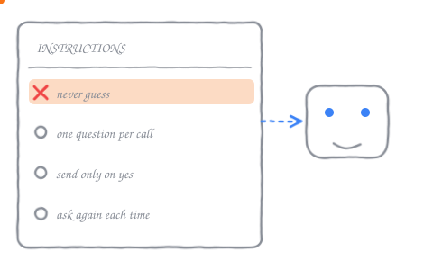

I send the model a block of text called INSTRUCTIONS when it connects. It says to call ask_landlord with one question per call and never guess a landlord's policy. It says to call send_question_to_landlord only after the renter says a clear yes. It says landlords add answers over time, so the model should call ask_landlord again every time. When a card is shown, it keeps its own text short.

**Why it matters.** The model follows these lines in every chat, so they are my cheapest safety rail. Without them it could invent a pet or deposit rule, or message a landlord unasked. Without the ask-again rule it would repeat an old not_answered result.

**Smallest pieces:**

- `INSTRUCTIONS`: The constant that holds the whole rulebook as one string.
- `instructions=INSTRUCTIONS`: Passes the text to MCPServer so the model receives it on connect.
- `status answered`: Rule: give the landlord's saved answer word for word.
- `status not_answered`: Rule: ask the renter first, and send only after a clear yes.
- `card rule`: Rule: keep chat text short when a card already shows the details.

**See the code:** [`leaseapp/mcp_server.py:25`](https://github.com/1AlgoRythm/LeaseBoston/blob/9f140fd2ef6d25c2a4d41b81522ebe0317c5771e/leaseapp/mcp_server.py#L25) · [`leaseapp/mcp_server.py:35`](https://github.com/1AlgoRythm/LeaseBoston/blob/9f140fd2ef6d25c2a4d41b81522ebe0317c5771e/leaseapp/mcp_server.py#L35) · [`leaseapp/mcp_server.py:41`](https://github.com/1AlgoRythm/LeaseBoston/blob/9f140fd2ef6d25c2a4d41b81522ebe0317c5771e/leaseapp/mcp_server.py#L41) · [`leaseapp/mcp_server.py:43`](https://github.com/1AlgoRythm/LeaseBoston/blob/9f140fd2ef6d25c2a4d41b81522ebe0317c5771e/leaseapp/mcp_server.py#L43) · [`leaseapp/mcp_server.py:49`](https://github.com/1AlgoRythm/LeaseBoston/blob/9f140fd2ef6d25c2a4d41b81522ebe0317c5771e/leaseapp/mcp_server.py#L49) · [`leaseapp/mcp_server.py:111`](https://github.com/1AlgoRythm/LeaseBoston/blob/9f140fd2ef6d25c2a4d41b81522ebe0317c5771e/leaseapp/mcp_server.py#L111)

### Tool contracts

*Typed inputs and outputs the model can read and obey*


I write each tool's inputs with Python types: Annotated, Field and Literal. The SDK turns them into JSON Schema, a machine-readable list of allowed values, such as min_beds from 0 to 6. Each tool returns dict[str, Any], which gives structured output. I mark search tools read-only and send_question_to_landlord idempotent, meaning a repeat does no extra harm. A fixable UserError becomes a ToolError the model can read, and two tools carry the ui:// card.

**Why it matters.** The schema stops the model from sending a bad value, such as an unknown pet type. Readable errors let the model fix its own mistake and retry. The hints let the chat app treat a read-only search without a safety prompt.

**Smallest pieces:**

- `Annotated / Field / Literal`: Declare the limits and allowed values of each input, such as limit between 1 and 10.
- `dict[str, Any]`: The return type that gives the model structured output.
- `READ`: Annotations marking a tool read-only; send_question_to_landlord sets its own idempotent hint.
- `user_errors`: Wrapper that turns service.UserError into a ToolError message.
- `apps.tool`: Decorator that binds search_apartments and ask_landlord to the card at ui://leaseboston/card.html.

**See the code:** [`leaseapp/mcp_server.py:64`](https://github.com/1AlgoRythm/LeaseBoston/blob/9f140fd2ef6d25c2a4d41b81522ebe0317c5771e/leaseapp/mcp_server.py#L64) · [`leaseapp/mcp_server.py:68`](https://github.com/1AlgoRythm/LeaseBoston/blob/9f140fd2ef6d25c2a4d41b81522ebe0317c5771e/leaseapp/mcp_server.py#L68) · [`leaseapp/mcp_server.py:74`](https://github.com/1AlgoRythm/LeaseBoston/blob/9f140fd2ef6d25c2a4d41b81522ebe0317c5771e/leaseapp/mcp_server.py#L74) · [`leaseapp/mcp_server.py:78`](https://github.com/1AlgoRythm/LeaseBoston/blob/9f140fd2ef6d25c2a4d41b81522ebe0317c5771e/leaseapp/mcp_server.py#L78) · [`leaseapp/mcp_server.py:90`](https://github.com/1AlgoRythm/LeaseBoston/blob/9f140fd2ef6d25c2a4d41b81522ebe0317c5771e/leaseapp/mcp_server.py#L90) · [`leaseapp/mcp_server.py:124`](https://github.com/1AlgoRythm/LeaseBoston/blob/9f140fd2ef6d25c2a4d41b81522ebe0317c5771e/leaseapp/mcp_server.py#L124)

## In-chat card (MCP App)

*Search results and answers drawn as a card inside the chat*

Diagram: [`card.html`](card.html)

I show results inside the chat as a card, a small web page the host draws in a locked-down box called a sandboxed iframe. The page is one file, app.html, with no outside scripts or fonts, because the default security policy would block them. It talks to the host with JSON-RPC (small JSON request and reply messages) sent over postMessage, following the 2026-01-26 spec. The tool result picks the view: matches become a carousel, and a status becomes an answer or a consent form. Both search_apartments and ask_landlord point at this card, and other hosts just get the same data as text.

**Why it matters.** Without a card, the renter would read long lists of listings as chat text. Keeping the card in one file with no network needs means it loads fast inside a sandbox. Hosts that ignore cards still work, because the same data comes back as text.

**Smallest pieces:**

- `app.html`: The single page that holds the styles, the message plumbing and both views.
- `CARD`: The ui:// address I register the page under, shared by two tools.
- `render`: Picks the carousel or the answer view from the tool result's structuredContent.
- `listings`: Draws the carousel view for search results.
- `answer`: Draws the landlord's answer or the consent form.

**See the code:** [`leaseapp/ui/app.html:3`](https://github.com/1AlgoRythm/LeaseBoston/blob/9f140fd2ef6d25c2a4d41b81522ebe0317c5771e/leaseapp/ui/app.html#L3) · [`leaseapp/ui/app.html:4`](https://github.com/1AlgoRythm/LeaseBoston/blob/9f140fd2ef6d25c2a4d41b81522ebe0317c5771e/leaseapp/ui/app.html#L4) · [`leaseapp/ui/app.html:11`](https://github.com/1AlgoRythm/LeaseBoston/blob/9f140fd2ef6d25c2a4d41b81522ebe0317c5771e/leaseapp/ui/app.html#L11) · [`leaseapp/ui/app.html:144`](https://github.com/1AlgoRythm/LeaseBoston/blob/9f140fd2ef6d25c2a4d41b81522ebe0317c5771e/leaseapp/ui/app.html#L144) · [`leaseapp/ui/app.html:145`](https://github.com/1AlgoRythm/LeaseBoston/blob/9f140fd2ef6d25c2a4d41b81522ebe0317c5771e/leaseapp/ui/app.html#L145) · [`leaseapp/mcp_server.py:56`](https://github.com/1AlgoRythm/LeaseBoston/blob/9f140fd2ef6d25c2a4d41b81522ebe0317c5771e/leaseapp/mcp_server.py#L56)

### Handshake with the host

*JSON-RPC messages over postMessage tell the host who I am*


I talk to the host in JSON-RPC, small JSON envelopes with an id, a method and params, sent by window.parent.postMessage. Each request gets a number, and I park its resolve and reject callbacks in a pending map until the reply with that id arrives. On load I send ui/initialize with my app name, protocol version 2026-01-26 and empty capabilities, then ui/notifications/initialized once the host replies. The host pushes tool-input and tool-result notifications, and a ResizeObserver reports my size with size-changed whenever the page grows or shrinks. Any other host request, like a teardown or ping, gets an empty result back so the host never waits on me.

**Why it matters.** Without the pending map, a reply could not be matched to the question that caused it. Without the initialize step, the host would not know the card is ready for results. Without size-changed, the iframe would stay the wrong height.

**Smallest pieces:**

- `request`: Sends a JSON-RPC request and returns a promise stored in the pending map under its id.
- `pending`: The map of waiting requests; a matching reply deletes its entry and resolves or rejects it.
- `notify`: Sends a JSON-RPC message with no id, so no reply is expected.
- `ui/initialize`: The first request, carrying appInfo, appCapabilities and protocolVersion 2026-01-26.
- `ResizeObserver`: Sends ui/notifications/size-changed with the page's width and height.

**See the code:** [`leaseapp/ui/app.html:96`](https://github.com/1AlgoRythm/LeaseBoston/blob/9f140fd2ef6d25c2a4d41b81522ebe0317c5771e/leaseapp/ui/app.html#L96) · [`leaseapp/ui/app.html:97`](https://github.com/1AlgoRythm/LeaseBoston/blob/9f140fd2ef6d25c2a4d41b81522ebe0317c5771e/leaseapp/ui/app.html#L97) · [`leaseapp/ui/app.html:105`](https://github.com/1AlgoRythm/LeaseBoston/blob/9f140fd2ef6d25c2a4d41b81522ebe0317c5771e/leaseapp/ui/app.html#L105) · [`leaseapp/ui/app.html:110`](https://github.com/1AlgoRythm/LeaseBoston/blob/9f140fd2ef6d25c2a4d41b81522ebe0317c5771e/leaseapp/ui/app.html#L110) · [`leaseapp/ui/app.html:119`](https://github.com/1AlgoRythm/LeaseBoston/blob/9f140fd2ef6d25c2a4d41b81522ebe0317c5771e/leaseapp/ui/app.html#L119) · [`leaseapp/ui/app.html:121`](https://github.com/1AlgoRythm/LeaseBoston/blob/9f140fd2ef6d25c2a4d41b81522ebe0317c5771e/leaseapp/ui/app.html#L121)

### Results carousel

*Matches and near misses scroll as snapping 248px tiles*


When the tool result has matches, I draw a rail of tiles, each 248px wide, that snaps into place as the renter scrolls. Each tile shows a badge like N% match, the monthly rent, the title, and facts such as neighborhood, beds, baths and square feet. Under that I show the first two reasons with a check mark, then a pets chip and two amenity chips. Near-miss listings follow as Almost tiles that show why they missed, with a cross instead of a check. Under the rail, the ‹ and › buttons and a 1 / N counter show where I am.

**Why it matters.** A tile has the same few facts every time, so the renter can compare listings by swiping instead of reading paragraphs. Showing near misses next to matches tells the renter which one filter to loosen. Setting text with textContent only means listing data can never be run as HTML.

**Smallest pieces:**

- `listings`: Builds the rail, the counter and the two arrow buttons from the matches and near_misses.
- `tile`: Builds one tile: badge, rent, title, facts, two reasons, chips and the ask buttons.
- `.tile`: Fixes each tile at 248px with scroll-snap-align start.
- `rail scroll handler`: Works out the tile number from scrollLeft and updates the 1 / N counter.
- `h`: The small DOM helper that sets text only, so data is never parsed as HTML.

**See the code:** [`leaseapp/ui/app.html:38`](https://github.com/1AlgoRythm/LeaseBoston/blob/9f140fd2ef6d25c2a4d41b81522ebe0317c5771e/leaseapp/ui/app.html#L38) · [`leaseapp/ui/app.html:152`](https://github.com/1AlgoRythm/LeaseBoston/blob/9f140fd2ef6d25c2a4d41b81522ebe0317c5771e/leaseapp/ui/app.html#L152) · [`leaseapp/ui/app.html:153`](https://github.com/1AlgoRythm/LeaseBoston/blob/9f140fd2ef6d25c2a4d41b81522ebe0317c5771e/leaseapp/ui/app.html#L153) · [`leaseapp/ui/app.html:154`](https://github.com/1AlgoRythm/LeaseBoston/blob/9f140fd2ef6d25c2a4d41b81522ebe0317c5771e/leaseapp/ui/app.html#L154) · [`leaseapp/ui/app.html:179`](https://github.com/1AlgoRythm/LeaseBoston/blob/9f140fd2ef6d25c2a4d41b81522ebe0317c5771e/leaseapp/ui/app.html#L179) · [`leaseapp/ui/app.html:123`](https://github.com/1AlgoRythm/LeaseBoston/blob/9f140fd2ef6d25c2a4d41b81522ebe0317c5771e/leaseapp/ui/app.html#L123)

### Ask landlord box

*The card asks the host to fill the renter's message box*


Each tile has an Ask landlord button that swaps itself for a text box and an Ask button. When the renter presses Ask or Enter, I send the host a ui/message request with role user and a content array of one text part. The text reads Ask the landlord of the listing id, then the question the renter typed. The host puts that text in the renter's message box, and the renter presses send, so the renter keeps the last word. A blank question sends nothing, because I only submit when the trimmed text is not empty.

**Why it matters.** If the card wrote straight to the landlord, a stray click could send a message the renter never reviewed. Going through the renter's own message box keeps a human yes in front of every question. The chat model then sees an ordinary user message and calls ask_landlord.

**Smallest pieces:**

- `say`: Sends ui/message with role user and a content array of one text part.
- `submit`: Sends the question only if the trimmed input is not empty.
- `Ask landlord button`: Hides the buttons and shows the question box, then focuses it.
- `Details button`: Uses the same say path to send Tell me more about the listing.
- `keydown handler`: Lets the renter press Enter instead of clicking Ask.

**See the code:** [`leaseapp/ui/app.html:100`](https://github.com/1AlgoRythm/LeaseBoston/blob/9f140fd2ef6d25c2a4d41b81522ebe0317c5771e/leaseapp/ui/app.html#L100) · [`leaseapp/ui/app.html:167`](https://github.com/1AlgoRythm/LeaseBoston/blob/9f140fd2ef6d25c2a4d41b81522ebe0317c5771e/leaseapp/ui/app.html#L167) · [`leaseapp/ui/app.html:168`](https://github.com/1AlgoRythm/LeaseBoston/blob/9f140fd2ef6d25c2a4d41b81522ebe0317c5771e/leaseapp/ui/app.html#L168) · [`leaseapp/ui/app.html:169`](https://github.com/1AlgoRythm/LeaseBoston/blob/9f140fd2ef6d25c2a4d41b81522ebe0317c5771e/leaseapp/ui/app.html#L169) · [`leaseapp/ui/app.html:170`](https://github.com/1AlgoRythm/LeaseBoston/blob/9f140fd2ef6d25c2a4d41b81522ebe0317c5771e/leaseapp/ui/app.html#L170) · [`leaseapp/ui/app.html:172`](https://github.com/1AlgoRythm/LeaseBoston/blob/9f140fd2ef6d25c2a4d41b81522ebe0317c5771e/leaseapp/ui/app.html#L172)

### Consent form

*The renter sends their own question to the landlord from the card*


When the landlord has not answered, I show a form with the renter's name, a channel and a contact. The channel is email, text, app notification or chat only, and the contact hint changes to match, or disappears for chat only. When the renter presses Send, I check the name is filled, then call send_question_to_landlord myself with a tools/call request and the reference code. On success I swap the form for Sent to the landlord, with the reference and how the reply will arrive. Then I tell the chat with a ui/message, so Claude knows not to send it again.

**Why it matters.** The renter's click on Send is the clear yes the server instructions require before anything reaches a landlord. Telling the chat afterward stops Claude from sending the same question a second time. A failed call re-enables the button and shows the error instead of losing the form.

**Smallest pieces:**

- `consentForm`: Builds the name, channel and contact fields and the Send button.
- `consentToggle`: On an answered card, hides the form behind a button reading Not quite it? Ask the landlord directly.
- `tools/call`: The request that runs send_question_to_landlord with reference_code, renter_name, channel and contact.
- `sent banner`: Replaces the form with the reference code and how_reply_arrives.
- `say`: Posts a ui/message saying the renter sent the question from the card.

**See the code:** [`leaseapp/ui/app.html:212`](https://github.com/1AlgoRythm/LeaseBoston/blob/9f140fd2ef6d25c2a4d41b81522ebe0317c5771e/leaseapp/ui/app.html#L212) · [`leaseapp/ui/app.html:217`](https://github.com/1AlgoRythm/LeaseBoston/blob/9f140fd2ef6d25c2a4d41b81522ebe0317c5771e/leaseapp/ui/app.html#L217) · [`leaseapp/ui/app.html:224`](https://github.com/1AlgoRythm/LeaseBoston/blob/9f140fd2ef6d25c2a4d41b81522ebe0317c5771e/leaseapp/ui/app.html#L224) · [`leaseapp/ui/app.html:229`](https://github.com/1AlgoRythm/LeaseBoston/blob/9f140fd2ef6d25c2a4d41b81522ebe0317c5771e/leaseapp/ui/app.html#L229) · [`leaseapp/ui/app.html:231`](https://github.com/1AlgoRythm/LeaseBoston/blob/9f140fd2ef6d25c2a4d41b81522ebe0317c5771e/leaseapp/ui/app.html#L231) · [`leaseapp/mcp_server.py:48`](https://github.com/1AlgoRythm/LeaseBoston/blob/9f140fd2ef6d25c2a4d41b81522ebe0317c5771e/leaseapp/mcp_server.py#L48)

## Question lifecycle

*A reference code and four statuses carry each question to its answer*

Diagram: [`lifecycle.html`](lifecycle.html)

I give every landlord question a short reference code and a status, and the status shows where it stands. A question starts as auto_answered when a saved answer matched, or not_sent when none did. It becomes waiting once the renter says yes and I send it, then replied when the landlord answers. The landlord's reply can also be saved as a new answer, so the next renter asking the same thing gets it instantly.

**Why it matters.** Each MCP call, one request from the model, arrives on its own, so the code and status are the only memory of a question. Without four clear statuses, I could not stop a double send or know when a reply is due.

**Smallest pieces:**

- `new_ref`: Mints the Q plus five character code that names one question.
- `questions.status`: Holds auto_answered, not_sent, waiting or replied for every question.
- `send_to_landlord`: Moves a question to waiting and notifies the landlord and the renter.
- `check_reply`: Reads a question's status by code and returns the reply once it exists.
- `landlord_reply`: Stores the reply, sets replied, and can save it as a new answer.

**See the code:** [`leaseapp/db.py:45`](https://github.com/1AlgoRythm/LeaseBoston/blob/9f140fd2ef6d25c2a4d41b81522ebe0317c5771e/leaseapp/db.py#L45) · [`leaseapp/service.py:62`](https://github.com/1AlgoRythm/LeaseBoston/blob/9f140fd2ef6d25c2a4d41b81522ebe0317c5771e/leaseapp/service.py#L62) · [`leaseapp/service.py:98`](https://github.com/1AlgoRythm/LeaseBoston/blob/9f140fd2ef6d25c2a4d41b81522ebe0317c5771e/leaseapp/service.py#L98) · [`leaseapp/service.py:119`](https://github.com/1AlgoRythm/LeaseBoston/blob/9f140fd2ef6d25c2a4d41b81522ebe0317c5771e/leaseapp/service.py#L119) · [`leaseapp/service.py:162`](https://github.com/1AlgoRythm/LeaseBoston/blob/9f140fd2ef6d25c2a4d41b81522ebe0317c5771e/leaseapp/service.py#L162)

### Reference code

*Each question gets a short readable code the model passes back*


I mint a reference code as Q plus five random characters, drawn with Python's secrets module, which is meant for hard-to-predict picks. The five characters come from 31 symbols with no 0, O, 1, I or L, so a code reads aloud cleanly. Each MCP call arrives alone, so I return the code and the model passes it back as a plain argument. The code's status is one of four words: auto_answered, not_sent, waiting or replied.

**Why it matters.** Nothing remembers an earlier call, so a later call needs a handle to name the question it means. Look-alike characters such as 0 and O would be misread when a code is spoken or typed. Redrawing a taken code keeps two questions from sharing one.

**Smallest pieces:**

- `new_ref`: Builds Q plus five characters and retries while the code is already in the questions table.
- `alphabet`: The 31 allowed symbols, with 0, O, 1, I and L left out.
- `_question`: Finds a question by its code, trimmed and upper-cased, or raises a fixable error.
- `reference_code argument`: The tool parameter the model fills with the code that ask_landlord returned.
- `questions.status`: The four statuses a code can show: auto_answered, not_sent, waiting, replied.

**See the code:** [`leaseapp/db.py:118`](https://github.com/1AlgoRythm/LeaseBoston/blob/9f140fd2ef6d25c2a4d41b81522ebe0317c5771e/leaseapp/db.py#L118) · [`leaseapp/db.py:120`](https://github.com/1AlgoRythm/LeaseBoston/blob/9f140fd2ef6d25c2a4d41b81522ebe0317c5771e/leaseapp/db.py#L120) · [`leaseapp/db.py:121`](https://github.com/1AlgoRythm/LeaseBoston/blob/9f140fd2ef6d25c2a4d41b81522ebe0317c5771e/leaseapp/db.py#L121) · [`leaseapp/db.py:45`](https://github.com/1AlgoRythm/LeaseBoston/blob/9f140fd2ef6d25c2a4d41b81522ebe0317c5771e/leaseapp/db.py#L45) · [`leaseapp/service.py:144`](https://github.com/1AlgoRythm/LeaseBoston/blob/9f140fd2ef6d25c2a4d41b81522ebe0317c5771e/leaseapp/service.py#L144) · [`leaseapp/mcp_server.py:127`](https://github.com/1AlgoRythm/LeaseBoston/blob/9f140fd2ef6d25c2a4d41b81522ebe0317c5771e/leaseapp/mcp_server.py#L127)

### Consent gate

*A question reaches the landlord only after the renter says yes*


I want a question to reach the landlord only after the renter says yes, and two things carry that rule. First, my server instructions tell the model to call send_question_to_landlord only after a clear yes, and the tool's own description repeats it. Second, the in-chat card has a Send to landlord button, so the renter's own click is the yes. The honest limit is that the tool stays visible to the model, so a text-only host relies on the model obeying my words. Nothing inside send_to_landlord checks for a yes, so the gate is a rule I ask for, not a lock.

**Why it matters.** Sending tells a real landlord by email, and nobody can unsend that. The card button makes consent a click the renter did, which is stronger than trusting the model. Where no card appears, only the instructions stand in the way, and I say so plainly.

**Smallest pieces:**

- `INSTRUCTIONS`: Tells the model to send only after a clear yes and never to resend after a card send.
- `send_question_to_landlord`: The tool whose description says to call it only after the renter clearly said yes.
- `consentForm`: The card's form: name, channel, contact and a Send to landlord button that calls the tool.
- `tool registration`: The tool is registered with no gate, so every host's model can see and call it.

**See the code:** [`leaseapp/mcp_server.py:41`](https://github.com/1AlgoRythm/LeaseBoston/blob/9f140fd2ef6d25c2a4d41b81522ebe0317c5771e/leaseapp/mcp_server.py#L41) · [`leaseapp/mcp_server.py:134`](https://github.com/1AlgoRythm/LeaseBoston/blob/9f140fd2ef6d25c2a4d41b81522ebe0317c5771e/leaseapp/mcp_server.py#L134) · [`leaseapp/mcp_server.py:47`](https://github.com/1AlgoRythm/LeaseBoston/blob/9f140fd2ef6d25c2a4d41b81522ebe0317c5771e/leaseapp/mcp_server.py#L47) · [`leaseapp/mcp_server.py:48`](https://github.com/1AlgoRythm/LeaseBoston/blob/9f140fd2ef6d25c2a4d41b81522ebe0317c5771e/leaseapp/mcp_server.py#L48) · [`leaseapp/ui/app.html:224`](https://github.com/1AlgoRythm/LeaseBoston/blob/9f140fd2ef6d25c2a4d41b81522ebe0317c5771e/leaseapp/ui/app.html#L224) · [`leaseapp/ui/app.html:233`](https://github.com/1AlgoRythm/LeaseBoston/blob/9f140fd2ef6d25c2a4d41b81522ebe0317c5771e/leaseapp/ui/app.html#L233)

### Idempotent send

*Sending twice changes nothing: the second call returns the status*


I check the contact first, and the rule depends on the channel the renter picked. Email must look like name@host.tld, sms needs at least 10 digits, and app needs a non-empty username or email. If the question is already waiting or replied, I return that status and send nothing, so a repeated call never sends twice. Otherwise I set the status to waiting, email the landlord, and send the renter a confirmation on their channel. For chat_only nothing goes to the renter, because that channel means they will check back in the chat.

**Why it matters.** A model can call a tool twice, and both the card and the model may try to send the same question. Returning the stored status turns a repeat into a harmless no-op, so the landlord gets one email per question. The tool is also annotated idempotent, meaning repeating it has no extra effect.

**Smallest pieces:**

- `_check_contact`: Rejects an unknown channel, a bad email, an sms number under 10 digits, or an empty app contact.
- `status guard`: Returns the existing status with the note 'Already sent. Nothing sent twice.' for waiting or replied.
- `UPDATE questions`: Sets status to waiting and stores the renter's name, channel, contact and sent time.
- `notify.send (landlord)`: Emails the landlord the question and a link to the reply page.
- `notify.send (renter)`: Sends the renter a confirmation with the reference code on their chosen channel.

**See the code:** [`leaseapp/service.py:91`](https://github.com/1AlgoRythm/LeaseBoston/blob/9f140fd2ef6d25c2a4d41b81522ebe0317c5771e/leaseapp/service.py#L91) · [`leaseapp/service.py:94`](https://github.com/1AlgoRythm/LeaseBoston/blob/9f140fd2ef6d25c2a4d41b81522ebe0317c5771e/leaseapp/service.py#L94) · [`leaseapp/service.py:95`](https://github.com/1AlgoRythm/LeaseBoston/blob/9f140fd2ef6d25c2a4d41b81522ebe0317c5771e/leaseapp/service.py#L95) · [`leaseapp/service.py:98`](https://github.com/1AlgoRythm/LeaseBoston/blob/9f140fd2ef6d25c2a4d41b81522ebe0317c5771e/leaseapp/service.py#L98) · [`leaseapp/service.py:102`](https://github.com/1AlgoRythm/LeaseBoston/blob/9f140fd2ef6d25c2a4d41b81522ebe0317c5771e/leaseapp/service.py#L102) · [`leaseapp/service.py:106`](https://github.com/1AlgoRythm/LeaseBoston/blob/9f140fd2ef6d25c2a4d41b81522ebe0317c5771e/leaseapp/service.py#L106)

### Reply becomes answer

*A landlord reply can be saved so later renters get it instantly*


When the landlord replies, landlord_reply checks the question is waiting for that landlord, then stores the reply and sets the status to replied. The landlord can also save the reply as a saved answer, for this unit only or for all their units, marked with source from_reply. Then I notify the renter on the channel they chose, and they can also read it in chat with check_landlord_reply. The next renter's ask_landlord reads every saved answer for that landlord, so the saved reply matches instantly with no wait.

**Why it matters.** Many renters ask a landlord the same things, so one slow reply can answer them all. Saving it turns that reply into an instant answer, and the landlord's queue shrinks over time. Without the save, each renter would wait for the same reply again.

**Smallest pieces:**

- `landlord_reply`: Checks the question is waiting for this landlord, stores the reply and sets replied.
- `save_as`: None, 'listing' for this unit only, or 'all' for every unit the landlord has.
- `_save_answer`: Inserts a saved_answers row; here the source is from_reply.
- `notify.send (renter)`: Messages the renter on their own channel; chat_only sends nothing.
- `ask_landlord candidates`: Reads the landlord's saved answers, including saved replies, to match the next question.

**See the code:** [`leaseapp/service.py:159`](https://github.com/1AlgoRythm/LeaseBoston/blob/9f140fd2ef6d25c2a4d41b81522ebe0317c5771e/leaseapp/service.py#L159) · [`leaseapp/service.py:162`](https://github.com/1AlgoRythm/LeaseBoston/blob/9f140fd2ef6d25c2a4d41b81522ebe0317c5771e/leaseapp/service.py#L162) · [`leaseapp/service.py:164`](https://github.com/1AlgoRythm/LeaseBoston/blob/9f140fd2ef6d25c2a4d41b81522ebe0317c5771e/leaseapp/service.py#L164) · [`leaseapp/service.py:166`](https://github.com/1AlgoRythm/LeaseBoston/blob/9f140fd2ef6d25c2a4d41b81522ebe0317c5771e/leaseapp/service.py#L166) · [`leaseapp/service.py:167`](https://github.com/1AlgoRythm/LeaseBoston/blob/9f140fd2ef6d25c2a4d41b81522ebe0317c5771e/leaseapp/service.py#L167) · [`leaseapp/service.py:51`](https://github.com/1AlgoRythm/LeaseBoston/blob/9f140fd2ef6d25c2a4d41b81522ebe0317c5771e/leaseapp/service.py#L51)

## Answer matcher

*Finds the landlord's saved answer, or admits there is none.*

Diagram: [`matcher.html`](matcher.html)

I decide whether a landlord already answered a renter's question, using plain code with no AI model. That means the same question always gets the same result. I turn each question into key words, then weigh each word by how rare it is across all saved questions. I score a pair of questions as the average of overlap and coverage, and I require a shared topic word. At 0.5 or higher I return the saved answer word for word; below that I answer nothing and offer to ask the landlord.

**Why it matters.** A confident wrong answer about a deposit or a pet rule can mislead a renter, so I only answer when the match is strong. Plain code gives the same result every time, which lets me pin each tricky case in a test. A miss just means a short wait for the landlord.

**Smallest pieces:**

- `keywords`: Turns a question into a set of canonical key words.
- `idf_weights`: Weights each word by how rare it is across saved questions.
- `score`: Averages overlap and coverage, and returns 0 without a shared topic word.
- `best_match`: Returns the top-scoring saved question, whatever its score.
- `ask_landlord`: Applies the 0.5 cut-off and decides answered or not_answered.

**See the code:** [`leaseapp/matcher.py:3`](https://github.com/1AlgoRythm/LeaseBoston/blob/9f140fd2ef6d25c2a4d41b81522ebe0317c5771e/leaseapp/matcher.py#L3) · [`leaseapp/matcher.py:22`](https://github.com/1AlgoRythm/LeaseBoston/blob/9f140fd2ef6d25c2a4d41b81522ebe0317c5771e/leaseapp/matcher.py#L22) · [`leaseapp/matcher.py:110`](https://github.com/1AlgoRythm/LeaseBoston/blob/9f140fd2ef6d25c2a4d41b81522ebe0317c5771e/leaseapp/matcher.py#L110) · [`leaseapp/service.py:56`](https://github.com/1AlgoRythm/LeaseBoston/blob/9f140fd2ef6d25c2a4d41b81522ebe0317c5771e/leaseapp/service.py#L56) · [`leaseapp/service.py:58`](https://github.com/1AlgoRythm/LeaseBoston/blob/9f140fd2ef6d25c2a4d41b81522ebe0317c5771e/leaseapp/service.py#L58) · [`tests/test_mvp.py:61`](https://github.com/1AlgoRythm/LeaseBoston/blob/9f140fd2ef6d25c2a4d41b81522ebe0317c5771e/tests/test_mvp.py#L61)

### Key words and synonyms

*Turns a question into a small set of canonical key words.*


I lower-case a question and pull out its words. I drop filler words like 'the' and 'is' (the STOPWORDS list), and listing ids like A201. I fold variants into one canonical word using SYNONYMS, so dog, cats and animal all become pet. Car, garage and driveway all become parking. Words with no synonym get a light stem, which cuts a plural 's' or turns 'ies' into 'y'.

**Why it matters.** Renters never phrase a question as a landlord saved it, so raw matching would miss 'can I park my car?' against 'Is parking available?'. Folding variants lets different wording land on the same word. Dropping filler keeps empty words from looking like a topic.

**Smallest pieces:**

- `keywords`: Lower-cases, drops stopwords and listing ids, and maps each word to its canonical form.
- `STOPWORDS`: Filler words such as a, the, is, can, my and please that are ignored.
- `SYNONYMS`: Maps variants to one word, like dog and cats to pet or car and garage to parking.
- `LISTING_ID`: A pattern for ids like A201 so they never count as a topic.
- `_stem`: Trims a plural 's' or turns a trailing 'ies' into 'y'.

**See the code:** [`leaseapp/matcher.py:63`](https://github.com/1AlgoRythm/LeaseBoston/blob/9f140fd2ef6d25c2a4d41b81522ebe0317c5771e/leaseapp/matcher.py#L63) · [`leaseapp/matcher.py:67`](https://github.com/1AlgoRythm/LeaseBoston/blob/9f140fd2ef6d25c2a4d41b81522ebe0317c5771e/leaseapp/matcher.py#L67) · [`leaseapp/matcher.py:69`](https://github.com/1AlgoRythm/LeaseBoston/blob/9f140fd2ef6d25c2a4d41b81522ebe0317c5771e/leaseapp/matcher.py#L69) · [`leaseapp/matcher.py:39`](https://github.com/1AlgoRythm/LeaseBoston/blob/9f140fd2ef6d25c2a4d41b81522ebe0317c5771e/leaseapp/matcher.py#L39) · [`leaseapp/matcher.py:40`](https://github.com/1AlgoRythm/LeaseBoston/blob/9f140fd2ef6d25c2a4d41b81522ebe0317c5771e/leaseapp/matcher.py#L40) · [`leaseapp/matcher.py:74`](https://github.com/1AlgoRythm/LeaseBoston/blob/9f140fd2ef6d25c2a4d41b81522ebe0317c5771e/leaseapp/matcher.py#L74)

### Rarity weights (IDF)

*Rare words count more than words every question uses.*

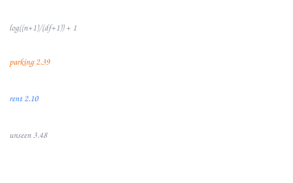

I count, for every word, how many saved questions use it; that count is its document frequency (df). The weight is log((n+1)/(df+1)) + 1, where n is the number of saved questions. A word used by fewer questions weighs more: with the 23 demo questions, parking is 2.39 and rent 2.10. A word no saved question uses counts as rare, so it gets the biggest weight I have computed. I count over every landlord's saved questions, not just the one being asked.

**Why it matters.** Without weights every shared word would count the same, and 'rent' or 'included' would drive a match as much as 'parking'. Weighting by rarity makes the distinctive topic word matter most. Unseen words count as rare so a renter's new word is never treated like filler.

**Smallest pieces:**

- `idf_weights`: Builds the word-to-weight table from all saved questions.
- `df`: A count of how many saved questions contain each word.
- `log((n+1)/(df+1)) + 1`: The weight formula, always at least 1.
- `unseen`: The largest weight in the table, used for a word no saved question has.
- `w`: A small helper that adds up the weights of a set of words.

**See the code:** [`leaseapp/matcher.py:7`](https://github.com/1AlgoRythm/LeaseBoston/blob/9f140fd2ef6d25c2a4d41b81522ebe0317c5771e/leaseapp/matcher.py#L7) · [`leaseapp/matcher.py:8`](https://github.com/1AlgoRythm/LeaseBoston/blob/9f140fd2ef6d25c2a4d41b81522ebe0317c5771e/leaseapp/matcher.py#L8) · [`leaseapp/matcher.py:89`](https://github.com/1AlgoRythm/LeaseBoston/blob/9f140fd2ef6d25c2a4d41b81522ebe0317c5771e/leaseapp/matcher.py#L89) · [`leaseapp/matcher.py:95`](https://github.com/1AlgoRythm/LeaseBoston/blob/9f140fd2ef6d25c2a4d41b81522ebe0317c5771e/leaseapp/matcher.py#L95) · [`leaseapp/matcher.py:104`](https://github.com/1AlgoRythm/LeaseBoston/blob/9f140fd2ef6d25c2a4d41b81522ebe0317c5771e/leaseapp/matcher.py#L104) · [`leaseapp/service.py:55`](https://github.com/1AlgoRythm/LeaseBoston/blob/9f140fd2ef6d25c2a4d41b81522ebe0317c5771e/leaseapp/service.py#L55)

### Overlap and coverage

*Scores a pair of questions by overlap and coverage.*


I score a renter's question against one saved question using the weights of their key words. Overlap is the shared weight divided by the weight of all words in either question. Coverage is the shared weight divided by the weight of the renter's words only. The score is the average of the two, 0.5 * (overlap + coverage). So a short question like 'can I park?' that a longer saved one fully covers still scores 0.68.

**Why it matters.** Overlap alone punishes short questions: 'can I park?' shares one word with a long saved question, so overlap is small. Coverage fixes that by asking how much of the renter's own question the saved one explains. Averaging keeps a long saved question from matching on one lucky word.

**Smallest pieces:**

- `score`: Compares one question with one saved question and returns a number from 0 to 1.
- `shared`: The summed weight of words both questions contain.
- `overlap`: Shared weight divided by the weight of the union of both word sets.
- `coverage`: Shared weight divided by the weight of the renter's words.
- `0.5 * (...)`: The plain average of overlap and coverage.

**See the code:** [`leaseapp/matcher.py:9`](https://github.com/1AlgoRythm/LeaseBoston/blob/9f140fd2ef6d25c2a4d41b81522ebe0317c5771e/leaseapp/matcher.py#L9) · [`leaseapp/matcher.py:10`](https://github.com/1AlgoRythm/LeaseBoston/blob/9f140fd2ef6d25c2a4d41b81522ebe0317c5771e/leaseapp/matcher.py#L10) · [`leaseapp/matcher.py:11`](https://github.com/1AlgoRythm/LeaseBoston/blob/9f140fd2ef6d25c2a4d41b81522ebe0317c5771e/leaseapp/matcher.py#L11) · [`leaseapp/matcher.py:12`](https://github.com/1AlgoRythm/LeaseBoston/blob/9f140fd2ef6d25c2a4d41b81522ebe0317c5771e/leaseapp/matcher.py#L12) · [`leaseapp/matcher.py:106`](https://github.com/1AlgoRythm/LeaseBoston/blob/9f140fd2ef6d25c2a4d41b81522ebe0317c5771e/leaseapp/matcher.py#L106) · [`leaseapp/matcher.py:107`](https://github.com/1AlgoRythm/LeaseBoston/blob/9f140fd2ef6d25c2a4d41b81522ebe0317c5771e/leaseapp/matcher.py#L107)

### Topic-word guard

*Requires a shared topic word, not just words like 'rent'.*


I keep a short list of GENERIC words: include, rent, cost, allow, month, schedule and sign. A match needs at least one shared word that is not on that list, or I score it 0. This fixed a bug where 'is parking included in rent?' got the utilities answer, matching only on 'include' and 'rent'. It also stops 'is that allowed?' from matching 'are pets allowed?'. Two tests pin both cases: A201 and 'Is that allowed?'.

**Why it matters.** A high score on common words is a false friend, because 'include' and 'rent' appear in many saved questions. Giving a renter the utilities answer to a parking question is a confident wrong answer, the worst failure here. Requiring a topic word makes the match mean something.

**Smallest pieces:**

- `GENERIC`: The words that say little about the topic.
- `(q & s) - GENERIC`: The shared words left after removing generic ones; if empty, the score is 0.
- `MATCH_CASES`: The table of renter questions and the saved question each must hit, or None.
- `test_saved_answer_matching`: Runs each case through ask_landlord and checks answered or not_answered.

**See the code:** [`leaseapp/matcher.py:14`](https://github.com/1AlgoRythm/LeaseBoston/blob/9f140fd2ef6d25c2a4d41b81522ebe0317c5771e/leaseapp/matcher.py#L14) · [`leaseapp/matcher.py:25`](https://github.com/1AlgoRythm/LeaseBoston/blob/9f140fd2ef6d25c2a4d41b81522ebe0317c5771e/leaseapp/matcher.py#L25) · [`leaseapp/matcher.py:28`](https://github.com/1AlgoRythm/LeaseBoston/blob/9f140fd2ef6d25c2a4d41b81522ebe0317c5771e/leaseapp/matcher.py#L28) · [`leaseapp/matcher.py:102`](https://github.com/1AlgoRythm/LeaseBoston/blob/9f140fd2ef6d25c2a4d41b81522ebe0317c5771e/leaseapp/matcher.py#L102) · [`tests/test_mvp.py:49`](https://github.com/1AlgoRythm/LeaseBoston/blob/9f140fd2ef6d25c2a4d41b81522ebe0317c5771e/tests/test_mvp.py#L49) · [`tests/test_mvp.py:50`](https://github.com/1AlgoRythm/LeaseBoston/blob/9f140fd2ef6d25c2a4d41b81522ebe0317c5771e/tests/test_mvp.py#L50)

### Fail-safe threshold

*Below 0.5 I stay silent and offer to ask the landlord.*

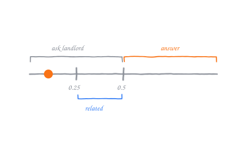

I answer only when the best score is at least MATCH_THRESHOLD, which is 0.5, and then I return the saved answer word for word. Below that I mark it not_answered, do not guess, and send it to the landlord only if the renter says yes. A score of 0.25 or more, the RELATED_FLOOR, also shows a related saved answer with a caution that it is not the same question. When two saved answers tie, the listing-specific one wins.

**Why it matters.** A wrong answer about a deposit or a pet rule can mislead a renter, while a miss only costs a short wait for the landlord. So a miss fails safe and nothing is said as fact. The related answer carries a warning, so a near miss still helps without pretending to be the answer.

**Smallest pieces:**

- `MATCH_THRESHOLD`: The 0.5 score at or above which the saved answer is returned.
- `RELATED_FLOOR`: The 0.25 score at or above which a related answer is shown with a caution.
- `hit`: True when the best match exists and its score reaches the threshold.
- `not_answered`: The result below the threshold, with a next step that says do not guess.
- `ORDER BY listing_id IS NULL`: Lists listing-specific answers first so they win a tie.

**See the code:** [`leaseapp/matcher.py:22`](https://github.com/1AlgoRythm/LeaseBoston/blob/9f140fd2ef6d25c2a4d41b81522ebe0317c5771e/leaseapp/matcher.py#L22) · [`leaseapp/service.py:10`](https://github.com/1AlgoRythm/LeaseBoston/blob/9f140fd2ef6d25c2a4d41b81522ebe0317c5771e/leaseapp/service.py#L10) · [`leaseapp/service.py:49`](https://github.com/1AlgoRythm/LeaseBoston/blob/9f140fd2ef6d25c2a4d41b81522ebe0317c5771e/leaseapp/service.py#L49) · [`leaseapp/service.py:58`](https://github.com/1AlgoRythm/LeaseBoston/blob/9f140fd2ef6d25c2a4d41b81522ebe0317c5771e/leaseapp/service.py#L58) · [`leaseapp/service.py:79`](https://github.com/1AlgoRythm/LeaseBoston/blob/9f140fd2ef6d25c2a4d41b81522ebe0317c5771e/leaseapp/service.py#L79)

## Search & ranking

*Filters out what cannot work, then scores and ranks the rest.*

Diagram: [`search.html`](search.html)

I take the renter's filters and every listing, and first drop the ones that cannot work, such as a rent over budget. Each survivor gets a fit score from 0 to 100, built from budget, commute distance and extras, with a plain reason per part. I sort by score, highest first, break ties with the lower rent, and return up to the limit, which defaults to 5. If fewer places fit than the limit, I also show listings that fail exactly one filter, so the renter knows what to loosen. Every search records an impression, a note that a listing was shown, for each match I return.

**Why it matters.** Hard filters keep impossible places away from the renter, and the score puts the best fit first. Plain reasons let the AI explain why a place fits instead of guessing. Near misses stop a strict search from ending in an empty answer.

**Smallest pieces:**

- `rank`: Splits listings into fits and misses, scores the fits, sorts them and adds near misses.
- `why_not`: Lists, in words, every hard filter a listing fails; an empty list means it passes.
- `score`: Combines the budget, commute and extras parts into one 0-100 number with reasons.
- `km_between`: Straight-line distance in kilometres between two latitude and longitude points.
- `search`: The service call that loads listings, runs rank and logs an impression per match.

**See the code:** [`leaseapp/ranking.py:3`](https://github.com/1AlgoRythm/LeaseBoston/blob/9f140fd2ef6d25c2a4d41b81522ebe0317c5771e/leaseapp/ranking.py#L3) · [`leaseapp/ranking.py:70`](https://github.com/1AlgoRythm/LeaseBoston/blob/9f140fd2ef6d25c2a4d41b81522ebe0317c5771e/leaseapp/ranking.py#L70) · [`leaseapp/ranking.py:79`](https://github.com/1AlgoRythm/LeaseBoston/blob/9f140fd2ef6d25c2a4d41b81522ebe0317c5771e/leaseapp/ranking.py#L79) · [`leaseapp/ranking.py:81`](https://github.com/1AlgoRythm/LeaseBoston/blob/9f140fd2ef6d25c2a4d41b81522ebe0317c5771e/leaseapp/ranking.py#L81) · [`leaseapp/service.py:19`](https://github.com/1AlgoRythm/LeaseBoston/blob/9f140fd2ef6d25c2a4d41b81522ebe0317c5771e/leaseapp/service.py#L19) · [`leaseapp/service.py:24`](https://github.com/1AlgoRythm/LeaseBoston/blob/9f140fd2ef6d25c2a4d41b81522ebe0317c5771e/leaseapp/service.py#L24)

### Hard filters

*Says in words which must-haves a listing fails.*


I check each listing against six filters: rent, bedrooms, pets, move-in date, must-have amenities and chosen neighborhoods. Every failed filter becomes a short sentence, such as a dollar amount over budget, or the list of missing amenities. For pets I use a small table, PET_OK, that says which listing policies suit a renter with no pet, a cat or a dog. An empty list means the listing passes, and I only score listings that come back empty.

**Why it matters.** Filters that fail in words let me show near misses and tell the renter exactly why a place was dropped. A silent yes or no would hide the one thing worth loosening. A listing that breaks a hard rule must never be scored as a good fit.

**Smallest pieces:**

- `why_not`: Returns a list of failed-filter sentences; empty means the listing passes.
- `PET_OK`: Maps the renter's pet (none, cat, dog) to the listing policies that allow it.
- `max_rent check`: Reports the dollars a listing is over the renter's maximum rent.
- `must_have check`: Collects the required amenities the listing lacks into one 'missing' sentence.
- `neighborhoods check`: Rejects a listing outside the chosen areas, ignoring upper or lower case.

**See the code:** [`leaseapp/ranking.py:30`](https://github.com/1AlgoRythm/LeaseBoston/blob/9f140fd2ef6d25c2a4d41b81522ebe0317c5771e/leaseapp/ranking.py#L30) · [`leaseapp/ranking.py:31`](https://github.com/1AlgoRythm/LeaseBoston/blob/9f140fd2ef6d25c2a4d41b81522ebe0317c5771e/leaseapp/ranking.py#L31) · [`leaseapp/ranking.py:27`](https://github.com/1AlgoRythm/LeaseBoston/blob/9f140fd2ef6d25c2a4d41b81522ebe0317c5771e/leaseapp/ranking.py#L27) · [`leaseapp/ranking.py:34`](https://github.com/1AlgoRythm/LeaseBoston/blob/9f140fd2ef6d25c2a4d41b81522ebe0317c5771e/leaseapp/ranking.py#L34) · [`leaseapp/ranking.py:43`](https://github.com/1AlgoRythm/LeaseBoston/blob/9f140fd2ef6d25c2a4d41b81522ebe0317c5771e/leaseapp/ranking.py#L43) · [`leaseapp/ranking.py:40`](https://github.com/1AlgoRythm/LeaseBoston/blob/9f140fd2ef6d25c2a4d41b81522ebe0317c5771e/leaseapp/ranking.py#L40)

### Fit score

*Averages budget, commute and extras into a 0-100 score.*


I score a listing with up to three parts, each between 0 and 1: budget fit, commute, and share of nice-to-have extras. Budget and commute each weigh 0.4 and extras weigh 0.2; I average only over the parts the renter actually asked about. The budget part reaches full marks when the rent is 25% under the maximum, and each part writes its own plain reason. I multiply the average by 100 and round it; with no parts at all I return 50 and 'matches your filters'.

**Why it matters.** Weights let a close, affordable place beat one that only has a long amenity list. Averaging only the parts that apply keeps a renter who skipped commute from being punished. The plain reasons are what lets the AI say why a place fits.

**Smallest pieces:**

- `score`: Builds the weighted parts and reasons, then returns a rounded 0-100 number and the list of reasons.
- `budget part`: Weight 0.4; capped at 1.0 once the rent is 25% under the maximum.
- `commute part`: Weight 0.4; one minus the kilometres divided by 5, never below 0.
- `extras part`: Weight 0.2; the share of nice-to-have amenities the listing has.
- `no-parts default`: Returns 50 when the renter gave nothing to score on.

**See the code:** [`leaseapp/ranking.py:7`](https://github.com/1AlgoRythm/LeaseBoston/blob/9f140fd2ef6d25c2a4d41b81522ebe0317c5771e/leaseapp/ranking.py#L7) · [`leaseapp/ranking.py:11`](https://github.com/1AlgoRythm/LeaseBoston/blob/9f140fd2ef6d25c2a4d41b81522ebe0317c5771e/leaseapp/ranking.py#L11) · [`leaseapp/ranking.py:53`](https://github.com/1AlgoRythm/LeaseBoston/blob/9f140fd2ef6d25c2a4d41b81522ebe0317c5771e/leaseapp/ranking.py#L53) · [`leaseapp/ranking.py:57`](https://github.com/1AlgoRythm/LeaseBoston/blob/9f140fd2ef6d25c2a4d41b81522ebe0317c5771e/leaseapp/ranking.py#L57) · [`leaseapp/ranking.py:61`](https://github.com/1AlgoRythm/LeaseBoston/blob/9f140fd2ef6d25c2a4d41b81522ebe0317c5771e/leaseapp/ranking.py#L61) · [`leaseapp/ranking.py:67`](https://github.com/1AlgoRythm/LeaseBoston/blob/9f140fd2ef6d25c2a4d41b81522ebe0317c5771e/leaseapp/ranking.py#L67)

### Commute distance

*Straight-line kilometres to a landmark, turned into a score.*


I measure the straight-line distance between a listing and a named landmark with the haversine formula, which treats Earth as a sphere. I use an Earth radius of 6371 km and real landmark coordinates that were looked up in Apple Maps. The commute score is 1 minus the distance divided by 5 km, so full marks at 0 km and zero from 5 km on. For the reason I also give walking minutes at 80 metres a minute, and I label it a straight line, not a route.

**Why it matters.** A straight line needs no routing service, so the demo works offline and gives the same answer every time. Labelling it a straight line keeps me from promising a walking route I did not compute. Real coordinates keep the distances believable.

**Smallest pieces:**

- `km_between`: Haversine distance in kilometres between two latitude and longitude points.
- `LANDMARKS`: Named places such as Northeastern University and MIT, each with real coordinates.
- `WALK_M_PER_MIN`: 80 metres per minute, about 5 km/h, used to turn kilometres into walking minutes.
- `commute part`: Computes 1 - km / 5, clamped at 0, with weight 0.4 in the fit score.

**See the code:** [`leaseapp/ranking.py:18`](https://github.com/1AlgoRythm/LeaseBoston/blob/9f140fd2ef6d25c2a4d41b81522ebe0317c5771e/leaseapp/ranking.py#L18) · [`leaseapp/ranking.py:24`](https://github.com/1AlgoRythm/LeaseBoston/blob/9f140fd2ef6d25c2a4d41b81522ebe0317c5771e/leaseapp/ranking.py#L24) · [`leaseapp/ranking.py:8`](https://github.com/1AlgoRythm/LeaseBoston/blob/9f140fd2ef6d25c2a4d41b81522ebe0317c5771e/leaseapp/ranking.py#L8) · [`leaseapp/ranking.py:58`](https://github.com/1AlgoRythm/LeaseBoston/blob/9f140fd2ef6d25c2a4d41b81522ebe0317c5771e/leaseapp/ranking.py#L58) · [`leaseapp/seed_data.py:9`](https://github.com/1AlgoRythm/LeaseBoston/blob/9f140fd2ef6d25c2a4d41b81522ebe0317c5771e/leaseapp/seed_data.py#L9) · [`leaseapp/seed_data.py:23`](https://github.com/1AlgoRythm/LeaseBoston/blob/9f140fd2ef6d25c2a4d41b81522ebe0317c5771e/leaseapp/seed_data.py#L23)

### Near misses

*Shows listings that fail just one filter, with the reason.*


When fewer listings fit than the limit, I look at the listings that were dropped and keep those that fail exactly one filter. I sort them by fewest failures, then lower rent, and fill only the empty spots up to the limit. Each near miss comes with why_not, the failed filter in words, so the renter learns which single filter to loosen. Separately, search writes an impression row, a record that a listing was shown, for every match I return.

**Why it matters.** A strict search that returns nothing leaves the renter stuck. One named filter to loosen is an easy next step. Logging impressions records what was shown, without storing anything about the renter.

**Smallest pieces:**

- `near_misses`: The result list of near-miss cards, each with a why_not list.
- `one_off`: Keeps only misses with exactly one failed filter.
- `limit - len(fits)`: Caps the near misses so matches plus near misses never exceed the limit.
- `impressions insert`: Search writes one row per match with its id and the time.

**See the code:** [`leaseapp/ranking.py:81`](https://github.com/1AlgoRythm/LeaseBoston/blob/9f140fd2ef6d25c2a4d41b81522ebe0317c5771e/leaseapp/ranking.py#L81) · [`leaseapp/ranking.py:83`](https://github.com/1AlgoRythm/LeaseBoston/blob/9f140fd2ef6d25c2a4d41b81522ebe0317c5771e/leaseapp/ranking.py#L83) · [`leaseapp/ranking.py:84`](https://github.com/1AlgoRythm/LeaseBoston/blob/9f140fd2ef6d25c2a4d41b81522ebe0317c5771e/leaseapp/ranking.py#L84) · [`leaseapp/ranking.py:82`](https://github.com/1AlgoRythm/LeaseBoston/blob/9f140fd2ef6d25c2a4d41b81522ebe0317c5771e/leaseapp/ranking.py#L82) · [`leaseapp/service.py:24`](https://github.com/1AlgoRythm/LeaseBoston/blob/9f140fd2ef6d25c2a4d41b81522ebe0317c5771e/leaseapp/service.py#L24)

## Landlord inbox

*The landlord's local web page for answering renter questions*

Diagram: [`inbox.html`](inbox.html)

I am the landlord's side of LeaseBoston: plain web pages, served by the same server as /mcp, where renter questions arrive. I answer only when the request's Host header, the website name the browser asked for, is localhost, 127.0.0.1 or [::1]. My Inbox tab shows four count tiles and every question, and my Saved answers tab holds the replies renters get instantly. My buttons call service.landlord_reply and service.add_saved_answer, so I hold no business rules myself.

**Why it matters.** I stay local because the page shows renters' contact details and has no login yet, so a public tunnel for ChatGPT exposes only /mcp. Keeping the rules in service.py means the chat tools and this page can never disagree about what a reply or a saved answer does.

**Smallest pieces:**

- `local_only`: Wraps every landlord route and refuses a non-local Host with a 403.
- `inbox`: Builds the stat tiles, the question list and the open question for one landlord.
- `answers`: Builds the Saved answers tab: add form, saved list and units table.
- `reply`: Takes the reply form post and hands it to service.landlord_reply.
- `add_saved`: Takes the add-answer form post and hands it to service.add_saved_answer.

**See the code:** [`leaseapp/landlord_web.py:4`](https://github.com/1AlgoRythm/LeaseBoston/blob/9f140fd2ef6d25c2a4d41b81522ebe0317c5771e/leaseapp/landlord_web.py#L4) · [`leaseapp/landlord_web.py:5`](https://github.com/1AlgoRythm/LeaseBoston/blob/9f140fd2ef6d25c2a4d41b81522ebe0317c5771e/leaseapp/landlord_web.py#L5) · [`leaseapp/service.py:1`](https://github.com/1AlgoRythm/LeaseBoston/blob/9f140fd2ef6d25c2a4d41b81522ebe0317c5771e/leaseapp/service.py#L1) · [`leaseapp/landlord_web.py:227`](https://github.com/1AlgoRythm/LeaseBoston/blob/9f140fd2ef6d25c2a4d41b81522ebe0317c5771e/leaseapp/landlord_web.py#L227) · [`leaseapp/landlord_web.py:239`](https://github.com/1AlgoRythm/LeaseBoston/blob/9f140fd2ef6d25c2a4d41b81522ebe0317c5771e/leaseapp/landlord_web.py#L239) · [`leaseapp/landlord_web.py:68`](https://github.com/1AlgoRythm/LeaseBoston/blob/9f140fd2ef6d25c2a4d41b81522ebe0317c5771e/leaseapp/landlord_web.py#L68)

### Localhost only

*Refuses any request whose Host is not localhost*


I read the Host header, the website name the browser asked for, on every landlord page request. If it is not 127.0.0.1, localhost or [::1], I answer 403, which means forbidden, with a one-line refusal. I wrap all seven landlord routes with local_only, so the inbox, saved answers, reply forms and outbox share one check. A public tunnel for ChatGPT therefore exposes /mcp but never the page that shows renters' contact details. There is no login yet, so this check is the only guard.

**Why it matters.** Without it, a tunnel meant to give ChatGPT the /mcp endpoint would also publish renters' names, emails and phone numbers. Because there is no login yet, a host check is the cheapest guard, and it refuses by default.

**Smallest pieces:**

- `LOCAL_HOSTS`: The three names counted as local: 127.0.0.1, localhost and [::1].
- `local_only`: A decorator, meaning a wrapper, that runs the Host check before the real handler.
- `rsplit(":", 1)[0]`: Cuts the port off the Host header so localhost:8000 still counts as localhost.
- `status_code=403`: The refusal a non-local Host gets, with the text 'only available on localhost'.
- `@local_only`: Stacked under each @mcp.custom_route so every page gets the check.

**See the code:** [`leaseapp/landlord_web.py:4`](https://github.com/1AlgoRythm/LeaseBoston/blob/9f140fd2ef6d25c2a4d41b81522ebe0317c5771e/leaseapp/landlord_web.py#L4) · [`leaseapp/landlord_web.py:5`](https://github.com/1AlgoRythm/LeaseBoston/blob/9f140fd2ef6d25c2a4d41b81522ebe0317c5771e/leaseapp/landlord_web.py#L5) · [`leaseapp/landlord_web.py:21`](https://github.com/1AlgoRythm/LeaseBoston/blob/9f140fd2ef6d25c2a4d41b81522ebe0317c5771e/leaseapp/landlord_web.py#L21) · [`leaseapp/landlord_web.py:70`](https://github.com/1AlgoRythm/LeaseBoston/blob/9f140fd2ef6d25c2a4d41b81522ebe0317c5771e/leaseapp/landlord_web.py#L70) · [`leaseapp/landlord_web.py:71`](https://github.com/1AlgoRythm/LeaseBoston/blob/9f140fd2ef6d25c2a4d41b81522ebe0317c5771e/leaseapp/landlord_web.py#L71) · [`leaseapp/landlord_web.py:108`](https://github.com/1AlgoRythm/LeaseBoston/blob/9f140fd2ef6d25c2a4d41b81522ebe0317c5771e/leaseapp/landlord_web.py#L108)

### Inbox and its four states

*Lists every question, waiting first, with a detail view per status*


I list every question for the landlord, waiting ones first, then the newest, each with a coloured status dot. The dots are amber for waiting, green for replied, blue for auto-answered and grey for not sent. The open question shows the listing, plus the renter and their reply channel (how they want to hear back) once it was sent. Under it, waiting gets a reply box, and replied shows the reply that was sent. Auto-answered shows the matched saved answer and its score, and not sent shows a form to add an answer.

**Why it matters.** Waiting first means a renter who is actually blocked is never buried under finished questions. Each status needs a different action, so showing only that action avoids a reply box on a question already answered. The score lets the landlord judge whether the saved answer really fitted.

**Smallest pieces:**

- `STATUS`: Maps the four status codes to the labels the landlord reads.
- `ORDER BY q.status = 'waiting' DESC`: Puts waiting questions first, then sorts by newest asked_at.
- `.dot classes`: One CSS class per status gives each list dot its colour.
- `detail`: Picks the panel under the open question from its status.
- `match_score`: The matcher's score, shown beside the saved answer that auto-answered the question.

**See the code:** [`leaseapp/landlord_web.py:42`](https://github.com/1AlgoRythm/LeaseBoston/blob/9f140fd2ef6d25c2a4d41b81522ebe0317c5771e/leaseapp/landlord_web.py#L42) · [`leaseapp/landlord_web.py:138`](https://github.com/1AlgoRythm/LeaseBoston/blob/9f140fd2ef6d25c2a4d41b81522ebe0317c5771e/leaseapp/landlord_web.py#L138) · [`leaseapp/landlord_web.py:170`](https://github.com/1AlgoRythm/LeaseBoston/blob/9f140fd2ef6d25c2a4d41b81522ebe0317c5771e/leaseapp/landlord_web.py#L170) · [`leaseapp/landlord_web.py:178`](https://github.com/1AlgoRythm/LeaseBoston/blob/9f140fd2ef6d25c2a4d41b81522ebe0317c5771e/leaseapp/landlord_web.py#L178) · [`leaseapp/landlord_web.py:180`](https://github.com/1AlgoRythm/LeaseBoston/blob/9f140fd2ef6d25c2a4d41b81522ebe0317c5771e/leaseapp/landlord_web.py#L180) · [`leaseapp/landlord_web.py:182`](https://github.com/1AlgoRythm/LeaseBoston/blob/9f140fd2ef6d25c2a4d41b81522ebe0317c5771e/leaseapp/landlord_web.py#L182)

### Inbox stat tiles

*Four tiles: waiting, auto-answered, not sent, search views*


I show four number tiles above the inbox: waiting for you, auto-answered, asked-not-sent and search views. I count the first three in Python from the question list I already fetched, so only the views number needs its own query. Search views counts rows in the impressions table, which logs each time a listing showed up in a renter's search results. I join those rows to this landlord's listings, so a search that shows three of their units adds three views.

**Why it matters.** The tiles tell a landlord what needs them now before they open a single question. Search views add context the questions cannot give, namely whether renters are seeing the units at all.

**Smallest pieces:**

- `count`: A small lambda that counts the landlord's questions with one given status.
- `views`: A COUNT of impressions joined to the listings this landlord owns.
- `impressions`: One row per listing shown in a search, written by service.search.
- `.stats`: A four-column grid for the tiles, two columns on a narrow screen.

**See the code:** [`leaseapp/landlord_web.py:139`](https://github.com/1AlgoRythm/LeaseBoston/blob/9f140fd2ef6d25c2a4d41b81522ebe0317c5771e/leaseapp/landlord_web.py#L139) · [`leaseapp/landlord_web.py:140`](https://github.com/1AlgoRythm/LeaseBoston/blob/9f140fd2ef6d25c2a4d41b81522ebe0317c5771e/leaseapp/landlord_web.py#L140) · [`leaseapp/landlord_web.py:141`](https://github.com/1AlgoRythm/LeaseBoston/blob/9f140fd2ef6d25c2a4d41b81522ebe0317c5771e/leaseapp/landlord_web.py#L141) · [`leaseapp/landlord_web.py:144`](https://github.com/1AlgoRythm/LeaseBoston/blob/9f140fd2ef6d25c2a4d41b81522ebe0317c5771e/leaseapp/landlord_web.py#L144) · [`leaseapp/landlord_web.py:145`](https://github.com/1AlgoRythm/LeaseBoston/blob/9f140fd2ef6d25c2a4d41b81522ebe0317c5771e/leaseapp/landlord_web.py#L145) · [`leaseapp/service.py:24`](https://github.com/1AlgoRythm/LeaseBoston/blob/9f140fd2ef6d25c2a4d41b81522ebe0317c5771e/leaseapp/service.py#L24)

### Saved answers tab

*Add reusable answers and see each unit's views and questions*


On the Saved answers tab, I let the landlord add a question and an answer that renters later get word for word. A drop-down sets the scope: all units, or one unit picked from the landlord's own listings. I list saved answers newest first and tag each with its source: seed (demo data), landlord (typed here) or from reply (saved while replying). Below that, a units table gives each unit's rent, search views and number of questions asked.

**Why it matters.** Saved answers are what lets a renter get an instant reply, so the landlord needs one place to add and review them. Scope matters because a unit-specific answer beats a landlord-wide one in a tie. The units table shows where views turn into questions.

**Smallest pieces:**

- `saved query`: Fetches this landlord's saved_answers, newest id first.
- `source label`: Shows seed, landlord or from reply by replacing the underscore in the stored source.
- `listing_id select`: Offers 'all units' plus one 'only' option per unit; empty means all units.
- `units query`: Counts impressions as shown and questions as asked, per listing.
- `add_saved_answer`: Saves the form with source 'landlord'; landlord_reply saves with 'from_reply'.

**See the code:** [`leaseapp/landlord_web.py:200`](https://github.com/1AlgoRythm/LeaseBoston/blob/9f140fd2ef6d25c2a4d41b81522ebe0317c5771e/leaseapp/landlord_web.py#L200) · [`leaseapp/landlord_web.py:202`](https://github.com/1AlgoRythm/LeaseBoston/blob/9f140fd2ef6d25c2a4d41b81522ebe0317c5771e/leaseapp/landlord_web.py#L202) · [`leaseapp/landlord_web.py:203`](https://github.com/1AlgoRythm/LeaseBoston/blob/9f140fd2ef6d25c2a4d41b81522ebe0317c5771e/leaseapp/landlord_web.py#L203) · [`leaseapp/landlord_web.py:207`](https://github.com/1AlgoRythm/LeaseBoston/blob/9f140fd2ef6d25c2a4d41b81522ebe0317c5771e/leaseapp/landlord_web.py#L207) · [`leaseapp/landlord_web.py:214`](https://github.com/1AlgoRythm/LeaseBoston/blob/9f140fd2ef6d25c2a4d41b81522ebe0317c5771e/leaseapp/landlord_web.py#L214) · [`leaseapp/db.py:36`](https://github.com/1AlgoRythm/LeaseBoston/blob/9f140fd2ef6d25c2a4d41b81522ebe0317c5771e/leaseapp/db.py#L36)

## Notifications

*Sends a message on the chosen channel and records it*


I deliver each message on one of four channels: email, sms, app or chat_only. Real email goes out only when the SMTP_HOST setting exists and the address does not end in example.com. Anything else is simulated, meaning I write the message to the outbox table instead of sending it. Every message gets an outbox row marked sent, simulated or failed. If the mail server breaks, I record the failure and the queue keeps working.

**Why it matters.** This matters because the demo has to run with no mail server and never email a stranger. Recording every message in one table lets anyone see exactly what would have been sent. Catching send errors stops one broken mail server from blocking every other message.

**Smallest pieces:**

- `CHANNELS`: The four allowed channels: email, sms, app and chat_only.
- `send`: Returns the status, and does nothing at all for chat_only, so the renter checks back in the chat.
- `example.com check`: Skips real sending for addresses on the reserved example.com domain, which cannot receive mail.
- `except Exception`: Catches any email error and stores it as a failed outbox row with the error text.
- `_smtp`: Builds the email from the SMTP_* settings and sends it with a 10 second timeout.

**See the code:** [`leaseapp/notify.py:23`](https://github.com/1AlgoRythm/LeaseBoston/blob/9f140fd2ef6d25c2a4d41b81522ebe0317c5771e/leaseapp/notify.py#L23) · [`leaseapp/notify.py:28`](https://github.com/1AlgoRythm/LeaseBoston/blob/9f140fd2ef6d25c2a4d41b81522ebe0317c5771e/leaseapp/notify.py#L28) · [`leaseapp/notify.py:31`](https://github.com/1AlgoRythm/LeaseBoston/blob/9f140fd2ef6d25c2a4d41b81522ebe0317c5771e/leaseapp/notify.py#L31) · [`leaseapp/notify.py:35`](https://github.com/1AlgoRythm/LeaseBoston/blob/9f140fd2ef6d25c2a4d41b81522ebe0317c5771e/leaseapp/notify.py#L35) · [`leaseapp/notify.py:38`](https://github.com/1AlgoRythm/LeaseBoston/blob/9f140fd2ef6d25c2a4d41b81522ebe0317c5771e/leaseapp/notify.py#L38)

## Data store

*One SQLite file, six tables, shared by two processes*


I keep everything in one SQLite file, a database in a single disk file, with six tables: landlords, listings, saved_answers, questions, outbox and impressions. Two processes open that file at once: the stdio server and the web server. So I switch on WAL mode, a write-ahead log that lets reads and writes overlap. On first run I create the tables and load the seed data. Reset deletes the file plus its -wal and -shm side files.

**Why it matters.** This matters because the chat server and the landlord page run as separate programs and must see the same questions. Without WAL, one process could block the other while it writes. Seeding on first run means the demo works with no setup.

**Smallest pieces:**

- `SCHEMA`: The CREATE TABLE statements for the six tables, run safely every time with IF NOT EXISTS.
- `connect`: Opens the file, turns on WAL mode and foreign keys, and waits up to 10 seconds on a lock.
- `init`: Creates the tables and seeds them only when the landlords table is empty.
- `init(reset=True)`: Deletes the database file and its -wal and -shm files before starting fresh.
- `_seed`: Copies the synthetic landlords, listings and saved answers into their tables.

**See the code:** [`leaseapp/db.py:3`](https://github.com/1AlgoRythm/LeaseBoston/blob/9f140fd2ef6d25c2a4d41b81522ebe0317c5771e/leaseapp/db.py#L3) · [`leaseapp/db.py:61`](https://github.com/1AlgoRythm/LeaseBoston/blob/9f140fd2ef6d25c2a4d41b81522ebe0317c5771e/leaseapp/db.py#L61) · [`leaseapp/db.py:80`](https://github.com/1AlgoRythm/LeaseBoston/blob/9f140fd2ef6d25c2a4d41b81522ebe0317c5771e/leaseapp/db.py#L80) · [`leaseapp/db.py:88`](https://github.com/1AlgoRythm/LeaseBoston/blob/9f140fd2ef6d25c2a4d41b81522ebe0317c5771e/leaseapp/db.py#L88) · [`leaseapp/db.py:92`](https://github.com/1AlgoRythm/LeaseBoston/blob/9f140fd2ef6d25c2a4d41b81522ebe0317c5771e/leaseapp/db.py#L92)

## Seed data

*Made-up Boston landlords, listings and answers for the demo*


I ship a synthetic Boston dataset: 6 landlords, 20 listings and 23 saved answers. Every name, price and answer is made up. The neighbourhood and landmark coordinates are real, looked up in Apple Maps on 2026-11-21. Some landlords deliberately have no saved answer on topics like guarantors, sublets or tours, so the send-to-landlord path shows up in the demo. All landlord emails use example.com, a reserved domain that cannot receive mail.

**Why it matters.** This matters because a demo needs realistic maps and distances without using any real person's data. The deliberate gaps force the demo to show the second path, where a question goes to the landlord. The example.com addresses guarantee no real inbox is ever emailed.

**Smallest pieces:**

- `NEIGHBORHOODS`: Nine neighbourhood centres with real latitude and longitude.
- `LANDMARKS`: Seven real landmarks, such as Northeastern University and MIT, used for distance questions.
- `LANDLORDS`: Six made-up landlords, each with an example.com email address.
- `_at`: Places a listing a few hundred metres from its neighbourhood centre.
- `SAVED_ANSWERS`: The 23 premade answers, each tied to one landlord and sometimes to one listing.

**See the code:** [`leaseapp/seed_data.py:1`](https://github.com/1AlgoRythm/LeaseBoston/blob/9f140fd2ef6d25c2a4d41b81522ebe0317c5771e/leaseapp/seed_data.py#L1) · [`leaseapp/seed_data.py:9`](https://github.com/1AlgoRythm/LeaseBoston/blob/9f140fd2ef6d25c2a4d41b81522ebe0317c5771e/leaseapp/seed_data.py#L9) · [`leaseapp/seed_data.py:5`](https://github.com/1AlgoRythm/LeaseBoston/blob/9f140fd2ef6d25c2a4d41b81522ebe0317c5771e/leaseapp/seed_data.py#L5) · [`leaseapp/seed_data.py:151`](https://github.com/1AlgoRythm/LeaseBoston/blob/9f140fd2ef6d25c2a4d41b81522ebe0317c5771e/leaseapp/seed_data.py#L151) · [`leaseapp/seed_data.py:152`](https://github.com/1AlgoRythm/LeaseBoston/blob/9f140fd2ef6d25c2a4d41b81522ebe0317c5771e/leaseapp/seed_data.py#L152)

## 29 tests and proof

*29 tests, five broken guards and real Claude runs back the claims.*

Diagram: [`tests.html`](tests.html)

I back every claim with 29 automated tests, and 18 of them are matching cases for the saved-answer matcher. Two journey tests start the real server as its own process and replay the full story over stdio (plain pipes) and HTTP. A mutation script then breaks five safety guards on purpose, and a guard only counts as protected if a test fails. Last, I run real Claude sessions and judge them by the database rows they leave, not by the chat text.

**Why it matters.** A green test only means something if it can also go red, so each guard is broken on purpose and a test must fail. Chat text can sound right while the database shows nothing was sent, so the rows are the honest witness.

**Smallest pieces:**

- `test_saved_answer_matching`: Runs 18 matching cases (10 must answer, 8 must go to the landlord) against a fresh temporary database.
- `journey`: One async function that plays the whole renter-and-landlord story, reused by the stdio and HTTP tests.
- `MUTATIONS`: Five (file, guard text, replacement, test selector) rows that tests/mutation_check.py breaks one at a time.
- `demo/run_demo.py`: Drives the real Claude Desktop app and the landlord page through seven scenes while recording the screen.

**See the code:** [`tests/test_mvp.py:1`](https://github.com/1AlgoRythm/LeaseBoston/blob/9f140fd2ef6d25c2a4d41b81522ebe0317c5771e/tests/test_mvp.py#L1) · [`README.md:191`](https://github.com/1AlgoRythm/LeaseBoston/blob/9f140fd2ef6d25c2a4d41b81522ebe0317c5771e/README.md#L191) · [`tests/mutation_check.py:54`](https://github.com/1AlgoRythm/LeaseBoston/blob/9f140fd2ef6d25c2a4d41b81522ebe0317c5771e/tests/mutation_check.py#L54) · [`demo/README.md:3`](https://github.com/1AlgoRythm/LeaseBoston/blob/9f140fd2ef6d25c2a4d41b81522ebe0317c5771e/demo/README.md#L3) · [`README.md:201`](https://github.com/1AlgoRythm/LeaseBoston/blob/9f140fd2ef6d25c2a4d41b81522ebe0317c5771e/README.md#L201)

### Journey over stdio and HTTP

*One story, replayed over stdio and HTTP against a real server.*


I write the whole renter-and-landlord story once, as a function called journey, and run it twice. Run one starts the server as a separate process and talks over stdio, which is how Claude Desktop runs it. Run two starts a real HTTP server on a free port, and the landlord's reply goes through the real web form. Both runs search, get a saved answer, get not_answered, send the question, read the reply, then get the new saved answer. Two extra tests check the tunnel: the landlord page answers 403 to the tunnel hostname, and /mcp rejects an unknown host.

**Why it matters.** One shared function means the two transports cannot drift apart, because the same asserts run on both. Unit tests alone would miss a bug in how the server starts or in the form post. The last step proves a landlord's reply really becomes a saved answer for the next renter.

**Smallest pieces:**

- `journey`: Checks the five tool names, then search, saved answer, not_answered, send, waiting, reply, replied and the new saved answer.
- `test_journey_over_stdio`: Launches python -m leaseapp stdio as a subprocess; the reply is written straight to the shared database.
- `http_server`: Starts the server on a free port with a tunnel hostname, waits until it listens, and terminates it afterwards.
- `test_journey_over_http_with_landlord_page`: Posts the reply to /landlord/L1/reply/<ref> exactly as the landlord's form would, then checks the page and outbox.
- `test_landlord_page_is_localhost_only`: Expects 403 for the tunnel hostname on /landlord and 200 for localhost.

**See the code:** [`tests/test_mvp.py:4`](https://github.com/1AlgoRythm/LeaseBoston/blob/9f140fd2ef6d25c2a4d41b81522ebe0317c5771e/tests/test_mvp.py#L4) · [`tests/test_mvp.py:132`](https://github.com/1AlgoRythm/LeaseBoston/blob/9f140fd2ef6d25c2a4d41b81522ebe0317c5771e/tests/test_mvp.py#L132) · [`tests/test_mvp.py:232`](https://github.com/1AlgoRythm/LeaseBoston/blob/9f140fd2ef6d25c2a4d41b81522ebe0317c5771e/tests/test_mvp.py#L232) · [`tests/test_mvp.py:238`](https://github.com/1AlgoRythm/LeaseBoston/blob/9f140fd2ef6d25c2a4d41b81522ebe0317c5771e/tests/test_mvp.py#L238) · [`tests/test_mvp.py:167`](https://github.com/1AlgoRythm/LeaseBoston/blob/9f140fd2ef6d25c2a4d41b81522ebe0317c5771e/tests/test_mvp.py#L167) · [`tests/test_mvp.py:256`](https://github.com/1AlgoRythm/LeaseBoston/blob/9f140fd2ef6d25c2a4d41b81522ebe0317c5771e/tests/test_mvp.py#L256)

### Mutation checks

*Five guards broken on purpose; a test must fail each time.*


I break each of five safety guards on purpose and check that a test notices. For every guard, tests/mutation_check.py swaps the exact guard text for a harmless replacement in the source file. It runs the single test that should notice, then always restores the real file, even if the run crashes. The five guards are the topic-word rule, the localhost-only landlord page, send-once, saving a reply as an answer, and landlord ownership. A guard counts as caught only when pytest exits with an error, and all 5 of 5 were caught.

**Why it matters.** A passing suite proves little until it can fail. Without this check, a guard could be deleted and every test would stay green, so a silent safety hole would ship.

**Smallest pieces:**

- `MUTATIONS`: Five rows of file, exact guard text, replacement, and the pytest -k selector that should fail.
- `GUARD NOT FOUND`: If the guard text does not appear exactly once, the guard is reported as missed instead of silently skipped.
- `write and restore`: The broken text is written, pytest runs, and a finally block puts the original file back.
- `caught`: A guard is caught when the pytest return code is not zero; the script prints how many of 5 are protected.

**See the code:** [`tests/mutation_check.py:3`](https://github.com/1AlgoRythm/LeaseBoston/blob/9f140fd2ef6d25c2a4d41b81522ebe0317c5771e/tests/mutation_check.py#L3) · [`tests/mutation_check.py:17`](https://github.com/1AlgoRythm/LeaseBoston/blob/9f140fd2ef6d25c2a4d41b81522ebe0317c5771e/tests/mutation_check.py#L17) · [`tests/mutation_check.py:41`](https://github.com/1AlgoRythm/LeaseBoston/blob/9f140fd2ef6d25c2a4d41b81522ebe0317c5771e/tests/mutation_check.py#L41) · [`tests/mutation_check.py:45`](https://github.com/1AlgoRythm/LeaseBoston/blob/9f140fd2ef6d25c2a4d41b81522ebe0317c5771e/tests/mutation_check.py#L45) · [`tests/mutation_check.py:50`](https://github.com/1AlgoRythm/LeaseBoston/blob/9f140fd2ef6d25c2a4d41b81522ebe0317c5771e/tests/mutation_check.py#L50) · [`tests/mutation_check.py:51`](https://github.com/1AlgoRythm/LeaseBoston/blob/9f140fd2ef6d25c2a4d41b81522ebe0317c5771e/tests/mutation_check.py#L51)

### Real Claude runs

*Real Claude sessions judged by database rows, not chat text.*


I run real Claude sessions and judge them by the database rows they leave, not by what the chat text says. Some runs used headless Claude Haiku (Claude Code with no window), over stdio and over HTTP. Others used the real Claude Desktop app, which demo/run_demo.py drives with typed keystrokes and button clicks across seven scenes. One run caught a bug: Claude answered a repeat question from chat history and did not call ask_landlord again, so it missed the new answer. I fixed it with a server instruction to call ask_landlord again every time, and the retake confirmed the fix.

**Why it matters.** A chat transcript can read fine while nothing was saved or sent, so the database is the only honest witness. Only a real model, run end to end, can show it skipping a tool call that the scripted tests always make.

**Smallest pieces:**

- `headless Haiku runs`: Claude Code sessions over stdio and HTTP, checked afterwards against the database.
- `demo/run_demo.py`: Resets the demo database, restarts Claude Desktop and the landlord server, then plays seven scenes.
- `wait_done`: Clicks Allow once when asked and waits until Stop response is gone, with a 200 second timeout.
- `step 7`: Opens a fresh chat and re-asks the bike question so it is answered from the landlord's new saved answer.
- `re-ask instruction`: The server instructions tell Claude to call ask_landlord again every time a question is asked.

**See the code:** [`README.md:201`](https://github.com/1AlgoRythm/LeaseBoston/blob/9f140fd2ef6d25c2a4d41b81522ebe0317c5771e/README.md#L201) · [`README.md:221`](https://github.com/1AlgoRythm/LeaseBoston/blob/9f140fd2ef6d25c2a4d41b81522ebe0317c5771e/README.md#L221) · [`leaseapp/mcp_server.py:43`](https://github.com/1AlgoRythm/LeaseBoston/blob/9f140fd2ef6d25c2a4d41b81522ebe0317c5771e/leaseapp/mcp_server.py#L43) · [`leaseapp/mcp_server.py:44`](https://github.com/1AlgoRythm/LeaseBoston/blob/9f140fd2ef6d25c2a4d41b81522ebe0317c5771e/leaseapp/mcp_server.py#L44) · [`demo/run_demo.py:213`](https://github.com/1AlgoRythm/LeaseBoston/blob/9f140fd2ef6d25c2a4d41b81522ebe0317c5771e/demo/run_demo.py#L213) · [`demo/run_demo.py:215`](https://github.com/1AlgoRythm/LeaseBoston/blob/9f140fd2ef6d25c2a4d41b81522ebe0317c5771e/demo/run_demo.py#L215)

## Demo recorder

*Scripts that drive Claude Desktop and record the demo video*

Diagram: [`demo.html`](demo.html)

I drive the real Claude Desktop app with a script, so the demo video shows a live chat and not a mock-up. I use agent-desktop, a command-line tool that reads each app's accessibility tree (the labelled list of buttons and fields it exposes). run_demo.py plays seven scenes while macOS screencapture records, and edit.py cuts the result into one video with a title card per scene. The whole run takes about 5 minutes with my hands off the keyboard, and the previous app comes back when it ends.

**Why it matters.** Without a script, the demo would be a hand-made screen capture that nobody could repeat exactly. A scripted run replays the same seven scenes after any design change, so I can re-record the video in minutes.

**Smallest pieces:**

- `ad.py`: A thin wrapper that runs one agent-desktop command and returns its JSON reply.
- `run_demo.py main`: Resets the demo data, restarts both apps, checks the layout, then plays the seven scenes.
- `step / end_step`: Log the label, start and end second of each scene into steps.json.
- `edit.py`: Cuts raw.mov and raw2.mov into leaseboston-demo.mp4 using ffmpeg.
- `SUBTITLES`: One caption per scene, shown on its title card.

**See the code:** [`demo/run_demo.py:1`](https://github.com/1AlgoRythm/LeaseBoston/blob/9f140fd2ef6d25c2a4d41b81522ebe0317c5771e/demo/run_demo.py#L1) · [`demo/run_demo.py:23`](https://github.com/1AlgoRythm/LeaseBoston/blob/9f140fd2ef6d25c2a4d41b81522ebe0317c5771e/demo/run_demo.py#L23) · [`demo/run_demo.py:213`](https://github.com/1AlgoRythm/LeaseBoston/blob/9f140fd2ef6d25c2a4d41b81522ebe0317c5771e/demo/run_demo.py#L213) · [`demo/run_demo.py:222`](https://github.com/1AlgoRythm/LeaseBoston/blob/9f140fd2ef6d25c2a4d41b81522ebe0317c5771e/demo/run_demo.py#L222) · [`demo/edit.py:1`](https://github.com/1AlgoRythm/LeaseBoston/blob/9f140fd2ef6d25c2a4d41b81522ebe0317c5771e/demo/edit.py#L1) · [`demo/README.md:26`](https://github.com/1AlgoRythm/LeaseBoston/blob/9f140fd2ef6d25c2a4d41b81522ebe0317c5771e/demo/README.md#L26)

### Accessibility driver

*Finds buttons by role and name, then acts on their refs*


I wrap the agent-desktop command-line tool in ad.run, which runs one command and parses its JSON reply. To find a control, I search the accessibility tree (the labelled list of buttons and fields an app exposes) by role and name. Each match carries a ref_id, a short handle that later click and type commands use as their target. A find that matches nothing still returns ok:true, so I count the matches instead of trusting the ok flag. To see if Claude is busy, I look for a 'Stop response' button every 1.5 seconds; two empty checks mean it is done.

**Why it matters.** If I trusted the ok flag, every search would look like a hit and the script would think Claude was always busy. It would then never move to the next scene. Searching by role and name also survives a button moving, where fixed screen coordinates would not.

**Smallest pieces:**

- `run`: Runs agent-desktop with optional --headed and returns the parsed JSON.
- `ref`: Finds one element by role and name and returns its ref_id, or None.
- `matches`: Returns the list of matches for a name, role and app, empty when nothing matches.
- `click`: Takes the chosen match and clicks its ref_id.
- `wait_done`: Polls every 1.5 s and returns once 'Stop response' has been gone for two checks in a row.

**See the code:** [`demo/ad.py:4`](https://github.com/1AlgoRythm/LeaseBoston/blob/9f140fd2ef6d25c2a4d41b81522ebe0317c5771e/demo/ad.py#L4) · [`demo/run_demo.py:78`](https://github.com/1AlgoRythm/LeaseBoston/blob/9f140fd2ef6d25c2a4d41b81522ebe0317c5771e/demo/run_demo.py#L78) · [`demo/run_demo.py:36`](https://github.com/1AlgoRythm/LeaseBoston/blob/9f140fd2ef6d25c2a4d41b81522ebe0317c5771e/demo/run_demo.py#L36) · [`demo/run_demo.py:43`](https://github.com/1AlgoRythm/LeaseBoston/blob/9f140fd2ef6d25c2a4d41b81522ebe0317c5771e/demo/run_demo.py#L43) · [`demo/run_demo.py:78`](https://github.com/1AlgoRythm/LeaseBoston/blob/9f140fd2ef6d25c2a4d41b81522ebe0317c5771e/demo/run_demo.py#L78) · [`demo/run_demo.py:81`](https://github.com/1AlgoRythm/LeaseBoston/blob/9f140fd2ef6d25c2a4d41b81522ebe0317c5771e/demo/run_demo.py#L81)

### Headed input

*Types with real keystrokes and sends by clicking the button*


Claude Desktop's message box ignores text typed in the background, so I type with agent-desktop's --headed mode, which sends real keystrokes. Real keystrokes use the live keyboard, so I keep my hands off until the script brings the previous app back. To send, send() fills the box and then clicks the 'Send message' button instead of pressing Return. Focus can sit on a card button in the chat, and Return would press that button instead of sending my message. When an approval prompt appears, wait_done pauses 1.2 seconds so a viewer can read it, then clicks 'Allow once'.

**Why it matters.** Background typing would leave the box empty, so the demo would send nothing. Clicking the named button sends the message whichever control holds focus. The price is that any touch of the keyboard during the run lands in the wrong place.

**Smallest pieces:**

- `run(..., headed=True)`: Puts --headed in front of the command so input arrives as real events.
- `type_into`: Finds a field by its placeholder text and types into the last match with headed=True.
- `send`: Tries three placeholder names, types, waits 0.6 s, then clicks 'Send message'.
- `wait_done approval`: Spots 'Allow once', waits 1.2 s for the viewer, then clicks it and keeps waiting.

**See the code:** [`demo/README.md:19`](https://github.com/1AlgoRythm/LeaseBoston/blob/9f140fd2ef6d25c2a4d41b81522ebe0317c5771e/demo/README.md#L19) · [`demo/ad.py:5`](https://github.com/1AlgoRythm/LeaseBoston/blob/9f140fd2ef6d25c2a4d41b81522ebe0317c5771e/demo/ad.py#L5) · [`demo/run_demo.py:51`](https://github.com/1AlgoRythm/LeaseBoston/blob/9f140fd2ef6d25c2a4d41b81522ebe0317c5771e/demo/run_demo.py#L51) · [`demo/run_demo.py:68`](https://github.com/1AlgoRythm/LeaseBoston/blob/9f140fd2ef6d25c2a4d41b81522ebe0317c5771e/demo/run_demo.py#L68) · [`demo/run_demo.py:76`](https://github.com/1AlgoRythm/LeaseBoston/blob/9f140fd2ef6d25c2a4d41b81522ebe0317c5771e/demo/run_demo.py#L76) · [`demo/run_demo.py:77`](https://github.com/1AlgoRythm/LeaseBoston/blob/9f140fd2ef6d25c2a4d41b81522ebe0317c5771e/demo/run_demo.py#L77)

### Recording and editing

*Records below the menu bar, pauses for new chats, speeds long scenes*


I record with macOS screencapture -v on the region 0,33,1512,949, which starts below the menu bar. Before recording, I check each window's x, width and height, retrying up to three times, and stop if a window is wrong. I stop the recording with SIGINT (the interrupt signal Ctrl-C sends) while a new chat opens, then start a second file, raw2.mov. edit.py puts a title card of 3.5 seconds before each scene and speeds up long scenes. It sets the speed to the clip length divided by 40, so no scene lasts longer than 40 seconds.

**Why it matters.** The sidebar would show my chat history while a new chat opens, so the recording pauses around it. Checking the layout first means a misplaced window stops the run in seconds, not after a five-minute take. Capping scenes at 40 seconds hides the waiting for Claude.

**Smallest pieces:**

- `screencapture -v -R0,33,1512,949`: Records video of one screen region; the 33 pixel offset skips the menu bar.
- `window check loop`: Tries up to three times to match each window's bounds, then exits with 'nothing recorded'.
- `new_chat`: Opens the sidebar, clicks New, hides the sidebar, and exits if either step failed.
- `MAX_SECONDS`: Caps each scene at 40 seconds by setting speed = max(1.0, dur / MAX_SECONDS).
- `steps.json`: Holds each scene's label, start and end second so edit.py knows where to cut.

**See the code:** [`demo/run_demo.py:140`](https://github.com/1AlgoRythm/LeaseBoston/blob/9f140fd2ef6d25c2a4d41b81522ebe0317c5771e/demo/run_demo.py#L140) · [`demo/run_demo.py:129`](https://github.com/1AlgoRythm/LeaseBoston/blob/9f140fd2ef6d25c2a4d41b81522ebe0317c5771e/demo/run_demo.py#L129) · [`demo/run_demo.py:208`](https://github.com/1AlgoRythm/LeaseBoston/blob/9f140fd2ef6d25c2a4d41b81522ebe0317c5771e/demo/run_demo.py#L208) · [`demo/run_demo.py:89`](https://github.com/1AlgoRythm/LeaseBoston/blob/9f140fd2ef6d25c2a4d41b81522ebe0317c5771e/demo/run_demo.py#L89) · [`demo/edit.py:13`](https://github.com/1AlgoRythm/LeaseBoston/blob/9f140fd2ef6d25c2a4d41b81522ebe0317c5771e/demo/edit.py#L13) · [`demo/edit.py:63`](https://github.com/1AlgoRythm/LeaseBoston/blob/9f140fd2ef6d25c2a4d41b81522ebe0317c5771e/demo/edit.py#L63)
